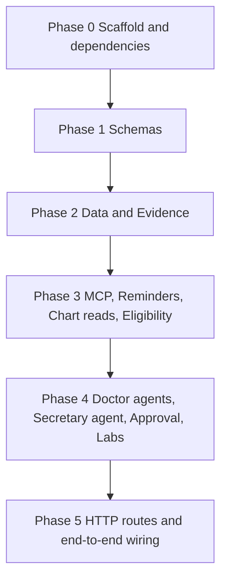

# Backend orchestrator

You are the orchestrator for the hackathon EMR backend. You do not implement a phase yourself. You spawn subagents, give each one a narrow brief, and you do not start the next phase until the current phase's tests pass.

Three files are the only sources of truth:

| File | Wins on |
|---|---|
| `backend-orchestrator.md` (this file) | phases, branches, who builds what and when, what is out of scope |
| `builder-contracts.md` | names, payloads, tables, owners, invariants |
| `system-design-routing-2.md` | behavior the other two do not specify |

If two of them disagree, the one listed first for that topic wins. Neither you nor any subagent opens, searches, or follows any other design file in this repo (`system-design-graph.md`, `system-design-routing.md`, `system-design-draft-1.md`, or anything else). When you search the repo, exclude them.

## Hard rules

- Do not build a frontend. Do not create `web/`, `mobile/`, or any UI. Do not spawn the Web or Mobile workers.
- Do not build ElevenLabs beyond a hook. Agents and services accept text. Only `POST /requests` may call a speech interface, and only in Phase 5. The default hook does not call ElevenLabs. `audio_base64` stays null. Real speech-to-text, speech synthesis, and voice UX wait until this backend is done.
- Test-driven development is required. For the phase you are starting, tests are written in their own subagent before application code. That subagent receives the contract excerpts and the function signatures only. It does not receive implementation files and it does not write application code. Implementation subagents start only after those tests exist and fail because the behavior is missing. Implementation must not weaken or delete a test to make it pass.
- A subagent edits only the paths listed for its worker. If two workers would edit the same file, run them one after the other, not in parallel.
- Do not add a JSON field that is not in `builder-contracts.md`.
- Do not add a dependency. Every dependency is declared in Phase 0. If a later worker needs a package that is not in `backend/pyproject.toml`, it stops and reports that to you, and you stop and ask the user.
- One exception to the contract's merge rule: `reminder_schedule` is written by `approve_suggestions` and by the manual reminder update. The manual update must not call the reminder agent. Every other chart table changes only inside `approve_suggestions`.
- Every phase has its own branch. Every subagent that will change files creates its own branch from that phase branch before editing. A read-only subagent does not get a branch.
- Run all phases back to back. Do not stop for the user's approval between phases. Stop only for `BLOCKED:` or `ALERT:` below, or when Phase 5 is done.
- Never delete a branch, local or remote.
- `backend/ingest/` already exists. It holds the evidence corpora (`corpus/*.jsonl`), the fictional payer documents, and the script that fetched them. No subagent edits it. Evidence tests may read the corpus files to back their fakes.
- Commit messages carry no Claude or AI attribution. No `Co-Authored-By` trailer, no "Generated with" line, for you and every subagent.

## Postgres and anything else only the user can provide

Tests from Phase 2 on run against a real Postgres (Tiger), not a fake and not SQLite. Vendors other than Postgres (Gemini, Snowflake, Twilio, ElevenLabs) are faked in every test and need no keys.

Before you spawn any subagent in Phase 2 or later, check that:

1. `backend/.env` exists and `DATABASE_URL` is set.
2. A connection to `DATABASE_URL` succeeds.
3. That role can `CREATE SCHEMA` and `CREATE EXTENSION IF NOT EXISTS vector` succeeds.

If `DATABASE_URL` is missing and the `tiger` CLI is installed and logged in, you may use it to look up the connection string of an existing Tiger service and write it to `backend/.env`. Do not create, fork, resize, or delete a Tiger service. That costs money and is the user's call.

If any check still fails, or a subagent reports it is blocked on a credential, account, or anything else only a human can set up, stop. Do not work around it, do not fall back to SQLite or a fake database, and do not keep working in the background. End your turn with a message whose first line is `BLOCKED: <what is missing>`. The following lines say exactly what you need the user to do (for example: "put a Tiger connection string in `backend/.env` as `DATABASE_URL`") and which phase is waiting. Never print a secret value in that message.

## Branches and commits

Work lands on `main` only after a finished phase branch is merged. Do not commit phase work directly to `main`.

1. Start the phase by creating its branch from `main`. Phase 0 branches from current `main`. Each later phase branches from `main` only after the previous phase branch has been merged into `main`.
2. Spawn the test subagents. Each creates its own branch from the tip of the phase branch and stops with the tests failing because the behavior is missing.
3. Merge each test branch into the phase branch with a merge commit (`--no-ff`). Do not squash and do not rebase the subagent commits away. Parallel test branches are cut from the same phase-branch tip, then merged back one at a time.
4. Confirm the merged tests fail for the missing behavior. Then spawn implementation subagents. Each one creates its own branch from that updated phase-branch tip.
5. Merge each implementation branch into the phase branch with `--no-ff`, one at a time. Run the phase tests on the phase branch. If they fail, or the merge conflicts, enter the repair loop below. They must pass before the next phase starts.
6. Merge the finished phase branch into `main` with `--no-ff`. Leave the phase commits and the subagent commits in the history.
7. Push `main` to `origin`. Also push the phase branch and every test, implementation, and fix branch from that phase, so they survive if this machine's checkout does not.

Do not force-push, amend, or squash these branches. Only you push. A subagent never pushes or merges its own branch. Do not have one subagent edit another subagent's branch. If a push is rejected, do not force it. Stop with `BLOCKED: push to origin rejected` and the git output.

## Repair loop

The failing tests written before implementation are not part of this loop. The loop starts only after an implementation or fix branch has been merged, when the phase tests still fail or two branches conflict.

Each pass of the loop is one new subagent, one new branch, one merge, and one test run:

1. Spawn a fix subagent in a fresh context. Give it the phase, the worker paths, the contract sections, and the failure output. It creates `phase-N/fix-<worker>-<attempt>` from the current phase-branch tip. A behavior failure may change only that worker's source paths. A test that does not match the contract may change only that worker's test path. A merge conflict may change only the conflicting files. It must not weaken or delete a contract assertion. It does not merge.
2. Merge that branch into the phase branch with `--no-ff` and run the phase tests again.

You may run this loop at most 4 times for one phase. If the tests still fail after the 4th run, or a 4th merge still conflicts, stop. Do not spawn a 5th subagent. Do not start the next phase. Do not keep working in the background.

Alert the user by ending your turn with a message whose first line is `ALERT: phase <N> still failing after 4 repairs`. The following lines name the branch, the four failure summaries, and that you are waiting. Ending the turn is what surfaces the alert in the Cursor app on the user's phone. Do not bury the alert inside another tool call.

A failure caused by Postgres being unreachable is not a repair-loop failure. Stop with `BLOCKED:` instead.

| Phase branch | Test branches | Implementation branches |
|---|---|---|
| `phase-0-scaffold` | `phase-0/tests-scaffold` | `phase-0/scaffold` |
| `phase-1-schemas` | `phase-1/tests-schemas` | `phase-1/schemas` |
| `phase-2-data-evidence` | `phase-2/tests-db`, `phase-2/tests-evidence` | `phase-2/data`, `phase-2/evidence` |
| `phase-3-tools-services` | `phase-3/tests-mcp`, `phase-3/tests-reminders`, `phase-3/tests-chart-reads`, `phase-3/tests-eligibility` | `phase-3/mcp`, `phase-3/reminders`, `phase-3/chart-reads`, `phase-3/eligibility` |
| `phase-4-agents-writers` | `phase-4/tests-doctor`, `phase-4/tests-secretary`, `phase-4/tests-approval`, `phase-4/tests-labs` | `phase-4/doctor-agents`, `phase-4/secretary`, `phase-4/approval`, `phase-4/labs` |
| `phase-5-http` | `phase-5/tests-api` | `phase-5/api` |

## How to spawn a subagent

Give every subagent this block, then the phase brief and its branch name:

```
Read builder-contracts.md for the sections named in your brief. Read system-design-routing-2.md only for behavior the contract does not specify.
Do not open, search, or follow any other design or markdown file in this repo. They are superseded drafts.
Create your branch from the phase branch tip you were given before you edit anything.
Stay on that branch. Commit your work. Do not merge, push, or rebase.
Commit messages have no Co-Authored-By trailer and no Claude or AI attribution.
Edit only the paths in your brief.
Do not build UI. Do not call ElevenLabs. Do not take patient identifiers into evidence functions.
Do not add dependencies. If you need one, stop and report it.
If you are blocked on a credential, account, or database only a human can provide, stop and report it.
Tests live under the test path in your brief. Application code lives under the source path.
Tests use the database fixtures in backend/tests/conftest.py. Do not edit that file. Put fixtures only your tests need in a conftest.py inside your own test directory.
If a repository function you need does not exist, compose existing ones in your own module. Do not edit backend/app/db/.
```

Spawn the test subagent first, in a fresh context. After its branch is merged and the new tests fail for the right reason, spawn the implementation subagents. Parallel implementation subagents are allowed only when the phase says so, each on its own branch from the same phase tip. When they return, merge those branches into the phase branch and run the phase tests yourself. If they fail, use the repair loop. Move on only when they pass.

A test that needs a function owned by another worker in the same phase fakes that function. It does not wait for the real one. Phase 5 is where the real functions meet.

## Phases



Phase 3 holds the tools and plain services that need only the database and evidence. Phase 4 holds the agents, which need MCP, and the two chart writers (approval and labs).

### Phase 0 — File structure, config, dependencies, and stubs

**Accomplish:** An importable backend skeleton with every dependency the backend will use. Later phases replace stub bodies. They do not invent paths, packages, or environment variable names.

**Branches:** `phase-0-scaffold`. Test subagent uses `phase-0/tests-scaffold`. Implementation uses `phase-0/scaffold`. No parallel workers.

**Workers:** One scaffold subagent. This is the only phase allowed to create files across worker directories, and only as stubs.

**Contract sections:** Workers, File structure, the route module list, and the internal function table. Do not create `web/` or `mobile/`.

**Tests first:** `backend/tests/scaffold/`. Assert the paths below exist and import, each public stub raises `NotImplementedError`, `.env.example` lists the variable names below, `.env` is gitignored, and no committed file contains a real key. These tests are temporary. See "After Phase 0" below.

**Implement:** `backend/pyproject.toml`, `backend/.gitignore`, `backend/.env.example`, `backend/app/config.py`, and the stub modules. `backend/.gitignore` covers `.env` and `storage/` (uploaded lab photos).

`pyproject.toml` declares every runtime and test dependency for all phases:

| Package | Used by |
|---|---|
| `fastapi` | API |
| `uvicorn[standard]` | running the app |
| `python-multipart` | `POST /documents`, `POST /requests` with audio, Twilio webhook form |
| `pydantic` | schemas |
| `python-dotenv` | `config.py` loading `backend/.env` |
| `sqlalchemy` (2.x) | models and repositories |
| `psycopg[binary]` (3.x) | Postgres driver |
| `pgvector` | `notes.embedding` |
| `httpx` | Snowflake Cortex Search REST, FastAPI test client |
| `google-genai` | Gemini model, vision, embeddings, Google Search grounding |
| `twilio` | WhatsApp reminders |
| `pytest` | tests (dev group) |

Do not add an ElevenLabs package, a Snowflake connector, or a Stedi client. Snowflake is called over REST with `httpx`.

`.env.example` holds empty values only. `config.py` reads these names and does not call a vendor:

- `DATABASE_URL`
- `GEMINI_API_KEY`
- `SNOWFLAKE_ACCOUNT`
- `SNOWFLAKE_PAT`
- `SNOWFLAKE_DATABASE`
- `SNOWFLAKE_SCHEMA`
- `TWILIO_ACCOUNT_SID`
- `TWILIO_AUTH_TOKEN`
- `TWILIO_FROM_NUMBER` (the WhatsApp sender, `whatsapp:+1...`)
- `ELEVENLABS_API_KEY`

`ELEVENLABS_API_KEY` is only a name in this phase. `config.py` also defines the constants from the contract's Locked choices: `GEMINI_MODEL = "gemini-3.6-flash"`, the embedding model and dimension, and the three Cortex Search service names. They are constants, not environment variables.

Create these files, with the public functions named in the contract, each raising `NotImplementedError`:

```
backend/app/schemas/
backend/app/db/models.py
backend/app/db/repositories/
backend/app/main.py
backend/seed/seed.py
backend/app/api/routes/body.py
backend/app/api/routes/requests.py
backend/app/api/routes/suggestions.py
backend/app/api/routes/documents.py
backend/app/api/routes/reminders.py
backend/app/api/routes/eligibility.py
backend/app/api/routes/appointments.py
backend/app/api/routes/secretary.py
backend/app/api/routes/webhooks.py
backend/app/mcp/tools.py
backend/app/agents/doctor/
backend/app/agents/secretary/
backend/app/services/chart.py
backend/app/services/appointments.py
backend/app/services/eligibility.py
backend/app/services/reminders.py
backend/app/services/sms.py
backend/app/services/approval.py
backend/app/services/labs.py
backend/app/evidence/
backend/app/speech/hook.py
```

`backend/app/main.py` builds a FastAPI app and includes the route modules. Route handlers and `SpeechHook.transcribe` / `SpeechHook.synthesize` raise `NotImplementedError`.

**Done when:** The scaffold tests pass, the app imports, `pip install -e backend[dev]` (or the equivalent) succeeds, and no stub contains database access, vendor calls, or business rules.

**After Phase 0:** Once `phase-0-scaffold` is merged into `main`, create `phase-1-schemas` and make its first commit yourself: delete `backend/tests/scaffold/`. Those tests assert stubs raise `NotImplementedError`, which stops being true in Phase 2.

### Phase 1 — Shared schemas

**Accomplish:** Later workers import one schema module instead of inventing field names.

**Branches:** `phase-1-schemas`. Test subagent uses `phase-1/tests-schemas`. Implementation uses `phase-1/schemas`.

**Workers:** Contracts only. No parallel work.

**Contract sections:** Locked choices, Errors, Shared types, and the column lists in Database.

**Tests first:** `backend/tests/schemas/`. Accept the suggestion, citation, and error examples from the contract. Reject a `target_table` outside the allowlist, an `after` key outside that table's keys, a bad condition or reminder status, and a missing error `code`.

**Implement:** `backend/app/schemas/` only.

**Done when:** The schema tests pass. Phase 0 stubs outside `backend/app/schemas/` still raise `NotImplementedError`.

### Phase 2 — Data and evidence, in parallel

**Before starting:** run the Postgres checks above. Stop with `BLOCKED:` if they fail.

**Accomplish:** A seeded Tiger database the rest of the backend can read, shared test fixtures every later phase uses, and evidence functions that search guidelines and payer text without ever seeing a patient row.

**Branches:** `phase-2-data-evidence`. Test branches `phase-2/tests-db` and `phase-2/tests-evidence` are cut in parallel from the same tip and merged before implementation. Implementation branches `phase-2/data` and `phase-2/evidence` then do the same.

**Workers in parallel:**

| Subagent | Branch | Owns | Contract sections |
|---|---|---|---|
| Data | `phase-2/data` | `backend/app/db/`, `backend/seed/` | Database, including the seed paragraph |
| Evidence | `phase-2/evidence` | `backend/app/evidence/` | Evidence tools |

**Tests first, separate files so the test subagents can run together:**

- `backend/tests/conftest.py` and `backend/tests/db/`, both owned by `phase-2/tests-db`. `conftest.py` provides the shared database fixtures for every later phase:
  - a session fixture that connects with `DATABASE_URL`, creates a uniquely named schema (`test_<random>`), creates the tables from `backend/app/db/models.py` in it, and drops that schema at the end. It never touches `public` or any existing schema.
  - a `db` fixture that gives each test a session inside a transaction that is rolled back afterward.
  - a `seeded_db` fixture that runs `backend/seed/seed.py` into the test schema and exposes the seeded patient ids.
  - if `DATABASE_URL` is missing or unreachable, the fixtures fail with a clear message naming `DATABASE_URL`. They do not skip and do not fall back.
- `backend/tests/db/` — repositories round-trip the contract columns for every table. Repositories include the reads later workers need: rows by patient for each chart table, conditions/medications/observations by `body_region_key`, `specialty_focus` by specialty, appointments by patient and by calendar date, suggestions by patient and status, inserting a suggestion, inserting a `requests` row, and Postgres full-text search over a patient's notes. `notes.embedding` is a nullable `vector(768)`. Seed loads several patients, each with conditions, medications, family history, observations, notes, a reminder schedule, one coverage row, and sample appointments. Seed also loads `body_regions`, `specialty_focus`, and `reminder_rules`. Seed does not call an agent or a vendor.
- `backend/tests/evidence/` — `search_guidelines(text, corpus)` allows `uspstf` and `pubmed` and returns `{ "passages": [citation, ...] }`. `search_payer_docs(text)` returns the same passage shape. `web_search(text)` returns `{ "text", "citations" }` with a URL `locator`. None of them accepts `patient_id`. Tests use fakes for Snowflake and Gemini. They do not need the database.
  - Each function raises `ValueError` (not empty passages) when the text contains a UUID, a member id in the seed's format, a phone number, or a full calendar date (`2026-09-01`, `09/01/2026`, `Sept 1, 2026`). An age (`52-year-old`), a bare year (`since 2019`), and a duration (`for 6 weeks`) are allowed.

**Done when:** Both test modules pass against the real Postgres. Evidence code does not import the database.

### Phase 3 — MCP, reminders, chart reads, and eligibility, in parallel

**Before starting:** run the Postgres checks above.

**Accomplish:** Agents have their only door into Tiger, due reminders can be sent without any agent running, the body view and appointments have services the routes can call, and eligibility works without an agent.

**Branches:** `phase-3-tools-services`. Four test branches, then four implementation branches, as listed in the branch table. Same merge rules as Phase 2.

**Workers in parallel, after Phase 2:**

| Subagent | Branch | Owns | Contract sections |
|---|---|---|---|
| MCP | `phase-3/mcp` | `backend/app/mcp/` | MCP tools |
| Reminders | `phase-3/reminders` | `backend/app/services/reminders.py`, `backend/app/services/sms.py` | Reminders and WhatsApp, Manual reminder edit, WhatsApp reminders invariant. Functions `send_due_reminders`, `update_reminder`, `handle_sms_webhook` |
| Chart reads | `phase-3/chart-reads` | `backend/app/services/chart.py`, `backend/app/services/appointments.py` | Doctor chart and body, the appointment routes, Appointments invariant. Functions `get_body_state`, `get_region`, `list_appointments`, `create_appointment`, `update_appointment` |
| Eligibility | `phase-3/eligibility` | `backend/app/services/eligibility.py` | Insurance and secretary (eligibility only), Eligibility invariant. Function `check_eligibility` |

**Tests first:**

- `backend/tests/mcp/` — `get_patient_context` returns the contract shape, including `pending_suggestions` with `unconfirmed: true`. `past_procedures` are encounters of type `procedure`. `search_patient_notes` returns excerpts and labs, found by full-text search, including seeded notes that have no embedding. `get_coverage` returns the coverage object or a not-found error. `propose_change` inserts one `pending` row, refuses a bad table or key, refuses a `reminder_change` with no citations, and does not update a chart table.
- `backend/tests/reminders/` — `send_due_reminders` sends only rows with `due_on <= as_of`, `status = scheduled`, and `sms_opt_in = true`. The message body has no diagnosis, medication, or lab. The row stores `twilio_sid` and the reminder becomes `sent`. Every message goes from the `whatsapp:` sender to `whatsapp:<phone_e164>`. `handle_sms_webhook` with `STOP` from `whatsapp:+1...` sets that patient's `sms_opt_in` false and does not change the chart. A status callback updates `sms_messages.status`. `update_reminder` changes only `due_on` or `status` and does not call the reminder agent. Twilio is a fake.
- `backend/tests/services/test_chart.py` — `get_body_state` returns the contract shape with `age` computed from `date_of_birth`, regions in the selected specialty marked `focus` and the rest `dim`, `pulse` true only for a region with an active condition in that specialty, a timeline built from conditions, medications, and encounters, and trends grouped by observation name. `get_region` returns that region's conditions, medications, and observations. An unknown patient or region is a not-found error.
- `backend/tests/services/test_appointments.py` — create, list by patient and by calendar date, and update any of `starts_at`, `ends_at`, `reason`, `status`. A bad `status` is rejected. No agent is imported.
- `backend/tests/services/test_eligibility.py` — `check_eligibility` reads `coverages` through the repository, not through MCP, and never calls Stedi. It stores one `eligibility_checks` row. `prior_auth` is null when `order_text` does not raise a prior-auth question. A prior-auth note cites `search_payer_docs`. Gemini and Snowflake are fakes.

**Done when:** All five test modules pass. Reminder, chart-read, and appointment code does not import `backend/app/agents/`.

### Phase 4 — Agents and chart writers, in parallel

**Before starting:** run the Postgres checks above.

**Accomplish:** A doctor request becomes suggestions or a cited answer, the reminder agent proposes schedule changes without writing them, the secretary can answer an insurance question without touching the chart, approving a suggestion is the one chart write, and a lab photo becomes observation suggestions.

**Branches:** `phase-4-agents-writers`. Four test branches, then four implementation branches, as listed in the branch table. Same merge rules as Phase 2.

**Workers in parallel, after Phase 3:**

| Subagent | Branch | Owns | Contract sections |
|---|---|---|---|
| Doctor agents | `phase-4/doctor-agents` | `backend/app/agents/doctor/` | Doctor request, Features for Chart update, Research, and Reminder agent. Functions `route_doctor_request` and `run_reminder_agent` |
| Secretary | `phase-4/secretary` | `backend/app/agents/secretary/` | Insurance and secretary (secretary chat only), Secretary chat invariant. Function `answer_secretary` |
| Approval | `phase-4/approval` | `backend/app/services/approval.py` | Suggestions, Approval invariant. Functions `approve_suggestions`, `reject_suggestions`, `list_suggestions`, `create_plan_item` |
| Labs | `phase-4/labs` | `backend/app/services/labs.py` | Documents, Lab photo invariant. Function `extract_lab_report` |

Approval calls `run_reminder_agent`, which the Doctor agents worker is building at the same time. Approval tests fake it. Phase 5 tests the real call.

**Tests first:**

- `backend/tests/agents/doctor/` — `route_doctor_request` stores one `requests` row and returns `chart_update` with pending suggestions and a null `answer`, or `clinical_question` with a cited `answer` and no suggestions, or `check_screenings` with either `reminder_change` suggestions or an up-to-date `answer`. Chart and reminder code call `propose_change` rather than chart tables. Research claims cite notes or `search_guidelines`. The reminder agent may request corpus `uspstf` only. Text passed to an evidence function contains no patient id, phone, member id, or full date. `run_reminder_agent` with trigger `post_approval` returns no suggestions when the schedule already matches, including the run that follows approval of a reminder change. Pending suggestions are labeled unconfirmed and are not treated as facts on the chart.
- `backend/tests/agents/secretary/` — `answer_secretary` stores one `requests` row with role `secretary`, may call `get_coverage`, `search_payer_docs`, and `web_search`, returns no suggestions, and does not call `propose_change`.
- `backend/tests/services/test_approval.py` — one transaction marks suggestions approved, applies `after` or the edited `after`, and writes `audit_log`. An edited key outside the allowlist is rejected. A `soap_note` or `plan_item` is written to `notes` with a 768-dimension embedding from the (faked) embedding call. Reject writes `audit_log` and leaves chart tables unchanged. Approving or rejecting something that is not `pending` is `invalid_state`. After the write, `run_reminder_agent(patient_id, "post_approval")` runs once (faked here). The suggestions it returns stay `pending`. `list_suggestions` defaults to `pending`. `create_plan_item` creates one pending `plan_item` with `source` `research_add_to_plan` through the suggestions repository, validated by the shared schema, and does not write the chart. Approval does not import `backend/app/mcp/`.
- `backend/tests/services/test_labs.py` — `extract_lab_report(patient_id, content, media_type)` saves the file under `backend/storage/` (a temporary folder in tests) and records its `storage_key` in `documents`, each analyte becomes one pending `observation` suggestion through the suggestions repository (validated by the shared schema, not `propose_change`), and `low_confidence` or `out_of_range` is copied onto `validation_flags`. `observations` gains no row until approval. Vision is a fake.

Model calls in tests are faked. `route_doctor_request` takes text that the test already produced. It does not transcribe audio.

**Done when:** All four test modules pass, no worker imported a speech client, and approval is the only new writer of `conditions`, `medications`, `family_history`, `observations`, and `notes`.

### Phase 5 — HTTP routes and end-to-end wiring

**Before starting:** run the Postgres checks above.

**Accomplish:** Every route in the contract returns the documented JSON, with the speech hook sitting on the voice request and nowhere else, and the functions built in parallel in Phase 4 work together.

**Branches:** `phase-5-http`. The test subagent uses `phase-5/tests-api`. The API subagent uses `phase-5/api`. Merge each into `phase-5-http` with `--no-ff` before merging the phase branch to `main`.

**Workers:** API only. No parallel work. Owns `backend/app/api/`, `backend/app/main.py`, and `backend/app/speech/hook.py`. Replace the Phase 0 route and speech stubs. Do not add a second app entry point.

**Contract sections:** API, all of it, plus the route module list and the internal function table.

**Tests first:** `backend/tests/api/`, one module per route group. Cover the success bodies in the contract and the error table: `400 validation_error`, `403 wrong_role`, `404 not_found`, `409 invalid_state`. Secretary-only routes reject `X-Role: doctor`. A missing role header is treated as `doctor`.

`POST /requests` with `text` never calls the speech hook. `POST /requests` with `audio` calls `SpeechHook.transcribe` and then `route_doctor_request` with that text. For a voice `chart_update`, `spoken_text` is set. `SpeechHook.synthesize` may be called and must be allowed to return null, which the response exposes as `audio_base64: null`. Tests use a fake hook. The real ElevenLabs adapter is a single module, `backend/app/speech/hook.py`, whose default implementation does not make a network call.

Add one end-to-end module, `backend/tests/api/test_end_to_end.py`, that fakes only Gemini, Snowflake, Twilio, and the speech hook. It runs a typed `chart_update` request, approves the returned suggestion, and checks that the real `run_reminder_agent` ran and `reminder_review` has the contract shape. It approves a resulting `reminder_change` and checks the follow-up review returns no suggestions.

Routes to cover:

| Module | Routes | Calls |
|---|---|---|
| `body.py` | `GET /patients/{patient_id}/body-state`, `GET /patients/{patient_id}/regions/{region_key}` | `get_body_state`, `get_region` |
| `requests.py` | `POST /requests` | `SpeechHook`, `route_doctor_request` |
| `suggestions.py` | `GET /suggestions`, `POST /suggestions`, `POST /suggestions/approve`, `POST /suggestions/reject` | `list_suggestions`, `create_plan_item`, `approve_suggestions`, `reject_suggestions` |
| `documents.py` | `POST /documents` | `extract_lab_report` |
| `reminders.py` | `PUT /patients/{patient_id}/reminders/{reminder_id}`, `POST /demo/run-reminders` | `update_reminder`, `send_due_reminders` |
| `eligibility.py` | `POST /patients/{patient_id}/eligibility` | `check_eligibility` |
| `appointments.py` | `GET /appointments`, `POST /appointments`, `PUT /appointments/{appointment_id}` | `list_appointments`, `create_appointment`, `update_appointment` |
| `secretary.py` | `POST /secretary/requests` | `answer_secretary` |
| `webhooks.py` | `POST /webhooks/twilio` | `handle_sms_webhook` |

Route functions call only the functions in the Calls column. They do not contain SQL, repository calls, or agent prompts.

**Done when:** The API tests pass, no `web/` or `mobile/` directory exists, and the only speech code is `backend/app/speech/hook.py` plus the call from `requests.py`.

## Not in these phases

- Doctor and secretary screens, the Expo app, and any other UI.
- A working ElevenLabs integration, audio streaming, and voice read-back quality.
- Stedi, a nightly reminder-agent job, scheduled reminder sending (only the demo route sends), Dictate/Ask routes, and Snowflake MCP.
- Loading `backend/ingest/corpus/*.jsonl` into Snowflake and creating the Cortex Search services. Evidence code is tested against fakes.
- Vector search over notes. Embeddings are stored, search is full-text.
