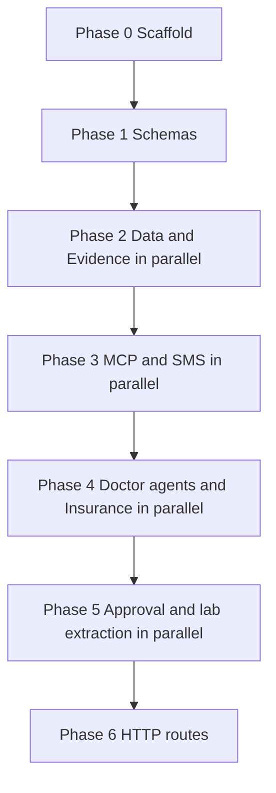

# Backend orchestrator

You are the orchestrator for the hackathon EMR backend. You do not implement a phase yourself. You spawn subagents, give each one a narrow brief, and you do not start the next phase until the current phase's tests pass.

Payloads, table columns, and invariants come from `builder-contracts.md`. Where that file disagrees with `system-design-graph.md`, follow `builder-contracts.md`. Behavior details it does not specify come from `system-design-routing-2.md`.

## Hard rules

- Do not build a frontend. Do not create `web/`, `mobile/`, or any UI. Do not spawn the Web or Mobile workers.
- Do not build ElevenLabs beyond a hook. Agents and services accept text. Only `POST /requests` may call a speech interface, and only in Phase 6. The default hook does not call ElevenLabs. `audio_base64` stays null. Real speech-to-text, speech synthesis, and voice UX wait until this backend is done.
- Test-driven development is required. For the phase you are starting, tests are written in their own subagent before application code. That subagent receives the contract excerpts and the function signatures only. It does not receive implementation files and it does not write application code. Implementation subagents start only after those tests exist and fail because the behavior is missing. Implementation must not weaken or delete a test to make it pass.
- A subagent edits only the paths listed for its worker. If two workers would edit the same file, run them one after the other, not in parallel.
- Do not add a JSON field that is not in `builder-contracts.md`.
- One exception to the contract's merge rule: `reminder_schedule` is written by `approve_suggestions` and by the manual reminder update. The manual update must not call the reminder agent. Every other chart table changes only inside `approve_suggestions`.
- Every phase has its own branch. Every subagent that will change files creates its own branch from that phase branch before editing. A read-only subagent does not get a branch.

## Branches and commits

Work lands on `main` only after a finished phase branch is merged. Do not commit phase work directly to `main`.

1. Start the phase by creating its branch from `main`. Phase 0 branches from current `main`. Each later phase branches from `main` only after the previous phase branch has been merged into `main`.
2. Spawn the test subagent. It creates its own branch from the tip of the phase branch, then makes at least two commits on that branch. One commit adds fixtures and fakes. A later commit adds the assertions. The branch stops with the tests failing because the behavior is missing.
3. Merge each test branch into the phase branch with a merge commit (`--no-ff`). Do not squash and do not rebase the subagent commits away. Parallel test branches are cut from the same phase-branch tip, then merged back one at a time.
4. Confirm the merged tests fail for the missing behavior. Then spawn implementation subagents. Each one creates its own branch from that updated phase-branch tip and makes at least two commits: the first wires the function or module so it can be imported, a later commit makes that worker's tests pass. Split further when the brief has distinct behaviors, one commit per behavior.
5. Merge each implementation branch into the phase branch with `--no-ff`, one at a time. Run the phase tests on the phase branch. If they fail, or the merge conflicts, enter the repair loop below. They must pass before the next phase starts.
6. Merge the finished phase branch into `main` with `--no-ff`. Leave the phase commits and the subagent commits in the history.

Do not force-push, amend, or squash these branches. A subagent never merges its own branch. You merge it. Do not have one subagent edit another subagent's branch.

## Repair loop

The failing tests written before implementation are not part of this loop. The loop starts only after an implementation or fix branch has been merged, when the phase tests still fail or two branches conflict.

Each pass of the loop is one new subagent, one new branch, one merge, and one test run:

1. Spawn a fix subagent in a fresh context. Give it the phase, the worker paths, the contract sections, and the failure output. It creates `phase-N/fix-<worker>-<attempt>` from the current phase-branch tip. A behavior failure may change only that worker's source paths. A test that does not match the contract may change only that worker's test path. A merge conflict may change only the conflicting files. It must not weaken or delete a contract assertion. It makes at least two commits and does not merge.
2. Merge that branch into the phase branch with `--no-ff` and run the phase tests again.

You may run this loop at most 4 times for one phase. If the tests still fail after the 4th run, or a 4th merge still conflicts, stop. Do not spawn a 5th subagent. Do not start the next phase. Do not keep working in the background.

Alert the user by ending your turn with a message whose first line is `ALERT: phase <N> still failing after 4 repairs`. The following lines name the branch, the four failure summaries, and that you are waiting. Ending the turn is what surfaces the alert in the Cursor app on the user's phone. Do not bury the alert inside another tool call.

| Phase branch | Test branches | Implementation branches |
|---|---|---|
| `phase-0-scaffold` | `phase-0/tests-scaffold` | `phase-0/scaffold` |
| `phase-1-schemas` | `phase-1/tests-schemas` | `phase-1/schemas` |
| `phase-2-data-evidence` | `phase-2/tests-db`, `phase-2/tests-evidence` | `phase-2/data`, `phase-2/evidence` |
| `phase-3-mcp-sms` | `phase-3/tests-mcp`, `phase-3/tests-reminders` | `phase-3/mcp`, `phase-3/reminders` |
| `phase-4-agents-insurance` | `phase-4/tests-doctor`, `phase-4/tests-insurance` | `phase-4/doctor-agents`, `phase-4/insurance` |
| `phase-5-approval-labs` | `phase-5/tests-approval`, `phase-5/tests-labs` | `phase-5/approval`, `phase-5/labs` |
| `phase-6-http` | `phase-6/tests-api` | `phase-6/api` |

## How to spawn a subagent

Give every subagent this block, then the phase brief and its branch name:

```
Read builder-contracts.md for the sections named in your brief.
Create your branch from the phase branch tip you were given before you edit anything.
Stay on that branch. Make at least two commits. Do not merge, push, or rebase.
Edit only the paths in your brief.
Do not build UI. Do not call ElevenLabs. Do not take patient identifiers into evidence functions.
Tests live under the test path in your brief. Application code lives under the source path.
```

Spawn the test subagent first, in a fresh context. After its branch is merged and the new tests fail for the right reason, spawn the implementation subagents. Parallel implementation subagents are allowed only when the phase says so, each on its own branch from the same phase tip. When they return, merge those branches into the phase branch and run the phase tests yourself. If they fail, use the repair loop. Move on only when they pass.

## Phases



### Phase 0 — File structure, config, and stubs

**Accomplish:** An importable backend skeleton. Later phases replace stub bodies. They do not invent paths, packages, or environment variable names.

**Branches:** `phase-0-scaffold`. Test subagent uses `phase-0/tests-scaffold`. Implementation uses `phase-0/scaffold`. Each branch has at least two commits before you merge it. No parallel workers.

**Workers:** One scaffold subagent. This is the only phase allowed to create files across worker directories, and only as stubs.

**Contract sections:** File structure, the route module list, and the internal function table. Do not create `web/` or `mobile/`.

**Tests first:** `backend/tests/scaffold/`. The first commit asserts the paths below exist and import. The second commit asserts each public stub raises `NotImplementedError`, `.env.example` lists the variable names below, `.env` is gitignored, and no committed file contains a real key.

**Implement:** `backend/pyproject.toml`, `backend/.gitignore`, `backend/.env.example`, `backend/app/config.py`, and the stub modules. `.env.example` holds empty values only. `config.py` reads these names and does not call a vendor:

- `DATABASE_URL`
- `GEMINI_API_KEY`
- `SNOWFLAKE_ACCOUNT`
- `SNOWFLAKE_USER`
- `SNOWFLAKE_PASSWORD`
- `SNOWFLAKE_WAREHOUSE`
- `SNOWFLAKE_DATABASE`
- `SNOWFLAKE_SCHEMA`
- `TWILIO_ACCOUNT_SID`
- `TWILIO_AUTH_TOKEN`
- `TWILIO_FROM_NUMBER`
- `ELEVENLABS_API_KEY`

`ELEVENLABS_API_KEY` is only a name in this phase. Do not add an ElevenLabs client or dependency.

Create these files, with the public functions named in the contract, each raising `NotImplementedError`:

```
backend/app/schemas/
backend/app/db/models.py
backend/app/db/repositories/
backend/app/main.py
backend/seed/seed.py
backend/app/api/routes/body.py
backend/app/api/routes/requests.py
backend/app/api/routes/suggestions.py
backend/app/api/routes/documents.py
backend/app/api/routes/reminders.py
backend/app/api/routes/eligibility.py
backend/app/api/routes/appointments.py
backend/app/api/routes/secretary.py
backend/app/api/routes/webhooks.py
backend/app/mcp/tools.py
backend/app/agents/doctor/
backend/app/agents/secretary/
backend/app/services/eligibility.py
backend/app/services/reminders.py
backend/app/services/sms.py
backend/app/services/approval.py
backend/app/services/labs.py
backend/app/evidence/
backend/app/speech/hook.py
```

`backend/app/main.py` builds a FastAPI app and includes the route modules. Route handlers and `SpeechHook.transcribe` / `SpeechHook.synthesize` raise `NotImplementedError`. The first implementation commit adds the project files and config. The second adds the stub modules.

**Done when:** The scaffold tests pass, the app imports, and no stub contains database access, vendor calls, or business rules.

### Phase 1 — Shared schemas

**Accomplish:** Later workers import one schema module instead of inventing field names.

**Branches:** `phase-1-schemas`. Test subagent uses `phase-1/tests-schemas`. Implementation uses `phase-1/schemas`. Each of those branches has at least two commits before you merge it.

**Workers:** Contracts only. No parallel work.

**Contract sections:** Locked choices, Errors, Shared types, and the column lists in Database.

**Tests first:** `backend/tests/schemas/`. Accept the suggestion, citation, and error examples from the contract. Reject a `target_table` outside the allowlist, an `after` key outside that table's keys, a bad condition or reminder status, and a missing error `code`.

**Implement:** `backend/app/schemas/` only.

**Done when:** The schema tests pass. Phase 0 stubs outside `backend/app/schemas/` still raise `NotImplementedError`.

### Phase 2 — Data and evidence, in parallel

**Accomplish:** A seeded Tiger database the rest of the backend can read, and evidence functions that search guidelines and payer text without ever seeing a patient row.

**Branches:** `phase-2-data-evidence`. Test branches `phase-2/tests-db` and `phase-2/tests-evidence` are cut in parallel from the same tip, each with at least two commits, and merged before implementation. Implementation branches `phase-2/data` and `phase-2/evidence` then do the same.

**Workers in parallel:**

| Subagent | Branch | Owns | Contract sections |
|---|---|---|---|
| Data | `phase-2/data` | `backend/app/db/`, `backend/seed/` | Database, including the seed paragraph |
| Evidence | `phase-2/evidence` | `backend/app/evidence/` | Evidence tools |

**Tests first, separate files so the test subagents can run together:**

- `backend/tests/db/` — repositories round-trip the contract columns. Seed loads several patients, each with conditions, medications, family history, observations, notes, a reminder schedule, one coverage row, and sample appointments. Seed does not call an agent or a vendor.
- `backend/tests/evidence/` — `search_guidelines(text, corpus)` allows `uspstf` and `pubmed` and returns `{ "passages": [citation, ...] }`. `search_payer_docs(text)` returns the same passage shape. `web_search(text)` returns `{ "text", "citations" }` with a URL `locator`. Each function refuses text that contains a patient id, member id, phone number, or date of birth, and none of them accepts `patient_id`. Tests use fakes. They do not require a live Snowflake or Gemini account.

**Done when:** Both test modules pass. Evidence code does not import the database.

### Phase 3 — MCP tools and reminder delivery, in parallel

**Accomplish:** Agents have their only door into Tiger, and due reminders can be sent without any agent running.

**Branches:** `phase-3-mcp-sms`. Test branches `phase-3/tests-mcp` and `phase-3/tests-reminders`, then implementation branches `phase-3/mcp` and `phase-3/reminders`. Same commit and merge rules as Phase 2.

**Workers in parallel, after Phase 2:**

| Subagent | Branch | Owns | Contract sections |
|---|---|---|---|
| MCP | `phase-3/mcp` | `backend/app/mcp/` | MCP tools |
| Reminders | `phase-3/reminders` | `backend/app/services/reminders.py`, `backend/app/services/sms.py` | Reminders and SMS, Manual reminder edit, SMS invariant |

**Tests first:**

- `backend/tests/mcp/` — `get_patient_context` returns the contract shape, including `pending_suggestions` with `unconfirmed: true`. `past_procedures` are encounters of type `procedure`. `search_patient_notes` returns excerpts and labs. `get_coverage` returns the coverage object or a not-found error. `propose_change` inserts one `pending` row, refuses a bad table or key, refuses a `reminder_change` with no citations, and does not update a chart table.
- `backend/tests/reminders/` — `send_due_reminders` sends only rows with `due_on <= as_of`, `status = scheduled`, and `sms_opt_in = true`. The message body has no diagnosis, medication, or lab. The row stores `twilio_sid` and the reminder becomes `sent`. `STOP` sets `sms_opt_in` false and does not change the chart. Updating `due_on` or `status` does not call the reminder agent. Twilio is a fake.

**Done when:** Both test modules pass. Reminder code does not import `backend/app/agents/`.

### Phase 4 — Doctor agents and insurance, in parallel

**Accomplish:** A doctor request becomes suggestions or a cited answer, the reminder agent proposes schedule changes without writing them, and the secretary can read coverage and answer an insurance question without touching the chart.

**Branches:** `phase-4-agents-insurance`. Test branches `phase-4/tests-doctor` and `phase-4/tests-insurance`, then implementation branches `phase-4/doctor-agents` and `phase-4/insurance`. Same commit and merge rules as Phase 2.

**Workers in parallel, after Phase 3:**

| Subagent | Branch | Owns | Contract sections |
|---|---|---|---|
| Doctor agents | `phase-4/doctor-agents` | `backend/app/agents/doctor/` | Doctor request, Features for Chart update, Research, and Reminder agent. Functions `route_doctor_request` and `run_reminder_agent` |
| Insurance | `phase-4/insurance` | `backend/app/services/eligibility.py`, `backend/app/agents/secretary/` | Insurance and secretary, Eligibility and Secretary chat invariants. Functions `check_eligibility` and `answer_secretary` |

**Tests first:**

- `backend/tests/agents/doctor/` — `route_doctor_request` returns `chart_update` with pending suggestions and a null `answer`, or `clinical_question` with a cited `answer` and no suggestions, or `check_screenings` with either `reminder_change` suggestions or an up-to-date `answer`. Chart and reminder code call `propose_change` rather than chart tables. Research claims cite notes or `search_guidelines`. The reminder agent may request corpus `uspstf` only. `run_reminder_agent` with trigger `post_approval` returns no suggestions when the schedule already matches, including the run that follows approval of a reminder change. Pending suggestions are labeled unconfirmed and are not treated as facts on the chart.
- `backend/tests/agents/secretary/` and `backend/tests/services/test_eligibility.py` — `check_eligibility` reads `coverages` through the repository, not through MCP, and never calls Stedi. It stores one `eligibility_checks` row. `prior_auth` is null when `order_text` does not raise a prior-auth question. A prior-auth note cites `search_payer_docs`. `answer_secretary` may call `get_coverage`, `search_payer_docs`, and `web_search`. It returns no suggestions and does not call `propose_change`.

Model calls in tests are faked. `route_doctor_request` takes text that the test already produced. It does not transcribe audio.

**Done when:** Both workers' tests pass and neither imported a speech client.

### Phase 5 — Approval and lab extraction, in parallel

**Accomplish:** Approving a suggestion is the one chart write and immediately re-checks reminder timing. A lab photo becomes observation suggestions and does not become observations until that approval.

**Branches:** `phase-5-approval-labs`. Test branches `phase-5/tests-approval` and `phase-5/tests-labs`, then implementation branches `phase-5/approval` and `phase-5/labs`. Same commit and merge rules as Phase 2.

**Workers in parallel, after Phase 4:**

| Subagent | Branch | Owns | Contract sections |
|---|---|---|---|
| Approval | `phase-5/approval` | `backend/app/services/approval.py` | Suggestions approve and reject, Approval invariant, `approve_suggestions` |
| Labs | `phase-5/labs` | `backend/app/services/labs.py` | Documents, Lab photo invariant, `extract_lab_report` |

**Tests first:**

- `backend/tests/services/test_approval.py` — one transaction marks suggestions approved, applies `after` or the edited `after`, and writes `audit_log`. A `soap_note` or `plan_item` is embedded into `notes`. Reject writes `audit_log` and leaves chart tables unchanged. Approving something that is not `pending` is `invalid_state`. After the write, `run_reminder_agent(patient_id, "post_approval")` runs once. The suggestions it creates stay `pending`.
- `backend/tests/services/test_labs.py` — the file is stored, each analyte becomes one pending `observation` suggestion, and `low_confidence` or `out_of_range` is copied onto `validation_flags`. `observations` gains no row until approval. Vision is a fake.

**Done when:** Both test modules pass. Approval is the only new writer of `conditions`, `medications`, `family_history`, `observations`, and `notes`.

### Phase 6 — HTTP routes

**Accomplish:** Every route in the contract returns the documented JSON, with the speech hook sitting on the voice request and nowhere else.

**Branches:** `phase-6-http`. The test subagent uses `phase-6/tests-api` and splits commits by route group, at least two commits. The API subagent uses `phase-6/api` and commits one route module at a time, so this branch has more than two commits. Merge each into `phase-6-http` with `--no-ff` before merging the phase branch to `main`.

**Workers:** API only. No parallel work. This phase starts after Phase 5. Replace the Phase 0 route and speech stubs. Do not add a second app entry point.

**Contract sections:** API, all of it, plus the route module list and the internal function table.

**Tests first:** `backend/tests/api/`, one module per route group. Cover the success bodies in the contract and the error table: `400 validation_error`, `403 wrong_role`, `404 not_found`, `409 invalid_state`. Secretary-only routes reject `X-Role: doctor`. A missing role header is treated as `doctor`.

`POST /requests` with `text` never calls the speech hook. `POST /requests` with `audio` calls `SpeechHook.transcribe` and then `route_doctor_request` with that text. For a voice `chart_update`, `spoken_text` is set. `SpeechHook.synthesize` may be called and must be allowed to return null, which the response exposes as `audio_base64: null`. Tests use a fake hook. The real ElevenLabs adapter is a single module, `backend/app/speech/hook.py`, whose default implementation does not make a network call.

Routes to cover:

| Module | Routes |
|---|---|
| `body.py` | `GET /patients/{patient_id}/body-state`, `GET /patients/{patient_id}/regions/{region_key}` |
| `requests.py` | `POST /requests` |
| `suggestions.py` | `GET /suggestions`, `POST /suggestions`, `POST /suggestions/approve`, `POST /suggestions/reject` |
| `documents.py` | `POST /documents` |
| `reminders.py` | `PUT /patients/{patient_id}/reminders/{reminder_id}`, `POST /demo/run-reminders` |
| `eligibility.py` | `POST /patients/{patient_id}/eligibility` |
| `appointments.py` | `GET /appointments`, `POST /appointments`, `PUT /appointments/{appointment_id}` |
| `secretary.py` | `POST /secretary/requests` |
| `webhooks.py` | `POST /webhooks/twilio` |

Route functions call the service functions from the contract. They do not contain SQL or agent prompts.

**Done when:** The API tests pass, no `web/` or `mobile/` directory exists, and the only speech code is `backend/app/speech/hook.py` plus the call from `requests.py`.

## Not in these phases

- Doctor and secretary screens, the Expo app, and any other UI.
- A working ElevenLabs integration, audio streaming, and voice read-back quality.
- Stedi, a nightly reminder job, Dictate/Ask routes, and Snowflake MCP.
