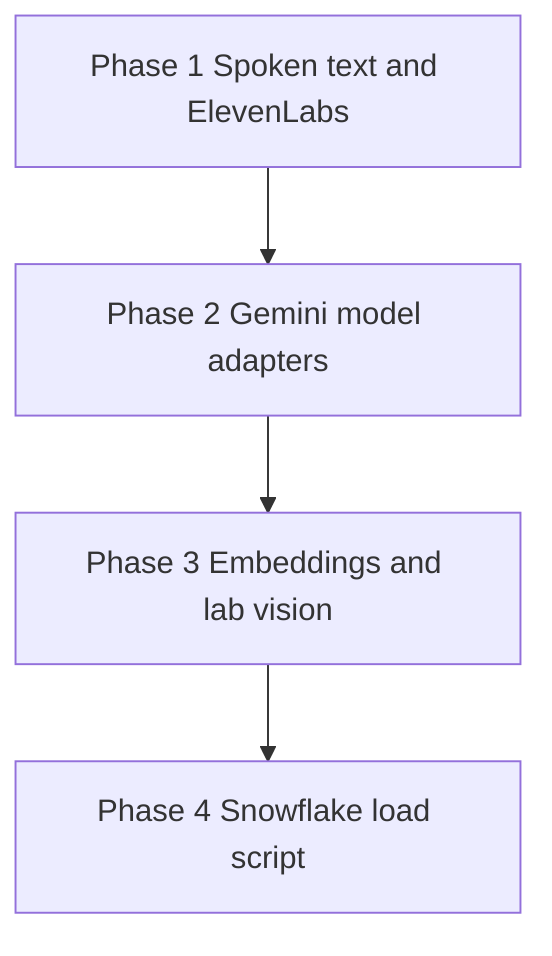

# Remaining-backend orchestrator

You are the orchestrator for the unfinished EMR backend. You do not implement a phase yourself. You spawn subagents, give each one only the brief written for it below, and you do not start the next phase until the current phase's tests pass.

This run starts from a `main` that already contains the hackathon backend and `backend-remaining.md`. It does not repeat `backend-orchestrator.md`. That file is a superseded build. Following it would block the ElevenLabs work this run exists to do.

Four files are the only sources of truth:

| File | Wins on |
|---|---|
| `backend-remaining-orchestrator.md` (this file) | phases, branches, who builds what and when, what is out of scope |
| `backend-remaining.md` | how the unfinished pieces call their vendors |
| `builder-contracts.md` | names, payloads, tables, owners, invariants |
| `system-design-routing-2.md` | behavior the other two do not specify |

If two of them disagree, the one listed first for that topic wins. Neither you nor any subagent opens, searches, or follows any other design file (`backend-orchestrator.md`, `system-design-graph.md`, `system-design-routing.md`, `system-design-draft-1.md`, or anything else). When you search the repo, exclude them.

## Hard rules

- Do not build a frontend. Do not create `web/` or `mobile/`. Do not edit `builder-contracts.md`, `backend-remaining.md`, or this file.
- Do not add a JSON field, a route, a table, or a dependency. `httpx` and `google-genai` are already declared. ElevenLabs is called with `httpx`. Gemini keeps `google-genai`.
- Test-driven development is required. For each worker, a test subagent writes tests in a fresh context before any implementation subagent for that worker starts. The test subagent does not receive implementation files and does not write application code. Implementation starts only after those tests are merged and the new assertions fail because the behavior is missing. Implementation must not weaken or delete a test to make it pass. Assertions that already pass on `main` must still pass.
- A subagent edits only the paths in its brief. If two workers would edit the same file, run them one after the other, not in parallel. The phases below are already split so parallel workers do not share a file.
- Every subagent is a new context. Do not resume a subagent for a different worker. Do not paste another worker's brief, diff, or source into a prompt. A fix subagent is also a new context.
- Every phase has its own branch. Every subagent that will change files creates its own branch from that phase branch before editing. A read-only subagent does not get a branch.
- Run the phases back to back. Do not stop for the user's approval between phases. Stop only for `BLOCKED:` or `ALERT:` below, or when Phase 4 is done.
- Never delete a branch, local or remote.
- Do not edit `backend/ingest/corpus/`, `backend/ingest/payer_docs/`, or `backend/ingest/fetch_corpus.py`. The only new ingest file is `backend/ingest/load_snowflake.py`, and only the Snowflake worker may create it.
- Commit messages carry no Claude or AI attribution. No `Co-Authored-By` trailer, no "Generated with" line, for you and every subagent.
- Agents still accept text. Only `POST /requests` calls `SpeechHook`. The doctor agent never imports ElevenLabs. `audio_base64` on the agent result stays null. The route is the only writer of a non-null `audio_base64`.

## Postgres and anything else only the user can provide

Phases 1, 2, and 3 run tests against the real Postgres (Tiger), not a fake and not SQLite. Gemini, Snowflake, Twilio, ElevenLabs, and S3 are faked in every test and need no keys.

Before you spawn any subagent in Phase 1, 2, or 3, check that:

1. `backend/.env` exists and `DATABASE_URL` is set.
2. A connection to `DATABASE_URL` succeeds.
3. That role can `CREATE SCHEMA` and `CREATE EXTENSION IF NOT EXISTS vector` succeeds.
4. `backend-remaining.md` is in the repo. If it is not, stop. Do not reconstruct it from memory.

If `DATABASE_URL` is missing and the `tiger` CLI is installed and logged in, you may use it to look up the connection string of an existing Tiger service and write it to `backend/.env`. Do not create, fork, resize, or delete a Tiger service.

If any check still fails, or a subagent reports it is blocked on a credential, account, or anything else only a human can provide, stop. Do not work around it, do not fall back to SQLite, and do not keep working in the background. End your turn with a message whose first line is `BLOCKED: <what is missing>`. The following lines say exactly what you need the user to do and which phase is waiting. Never print a secret value in that message.

Phase 4 does not need Postgres. It does not call Snowflake. Live loading is not a phase. See "After Phase 4".

## Branches and commits

Work lands on `main` only after a finished phase branch is merged. Do not commit phase work directly to `main`.

1. Start the phase by creating its branch from `main`. Phase 1 branches from current `main`. Each later phase branches from `main` only after the previous phase branch has been merged into `main`.
2. Spawn the test subagents. Each creates its own branch from the tip of the phase branch and stops with the new tests failing because the behavior is missing, and with the already-passing tests in its brief still passing.
3. Merge each test branch into the phase branch with a merge commit (`--no-ff`). Do not squash and do not rebase the subagent commits away. Parallel test branches are cut from the same phase-branch tip, then merged back one at a time.
4. Confirm the merged new tests fail for the missing behavior. A collection error, an assertion that already passes, or an assertion that contradicts the contract is the wrong failure. Do not start that worker's implementation. Spawn one replacement test subagent on `remain-N/tests-<worker>-rewrite`, merge it, and check again. If the second attempt is also wrong, stop with `ALERT:` as in the repair loop. Do not burn an implementation repair on a bad test.
5. Spawn implementation subagents. Each one creates its own branch from that updated phase-branch tip.
6. Merge each implementation branch into the phase branch with `--no-ff`, one at a time. Run the phase tests on the phase branch. If they fail, or the merge conflicts, enter the repair loop below. They must pass before the next phase starts.
7. Merge the finished phase branch into `main` with `--no-ff`. Leave the phase commits and the subagent commits in the history.
8. Push `main` to `origin`. Also push the phase branch and every test, implementation, and fix branch from that phase, so they survive if this machine's checkout does not.

Do not force-push, amend, or squash these branches. Only you push. A subagent never pushes or merges its own branch. Do not have one subagent edit another subagent's branch. If a push is rejected, do not force it. Stop with `BLOCKED: push to origin rejected` and the git output.

## Repair loop

The failing tests written before implementation are not part of this loop. The loop starts only after an implementation or fix branch has been merged, when the phase tests still fail or two branches conflict.

Each pass of the loop is one new subagent, one new branch, one merge, and one test run:

1. Spawn a fix subagent in a fresh context. Give it the phase, that one worker's brief, the contract sections, and the failure output. It creates `remain-N/fix-<worker>-<attempt>` from the current phase-branch tip. A behavior failure may change only that worker's source paths. A test that does not match the contract may change only that worker's test path. A merge conflict may change only the conflicting files. It must not weaken or delete a contract assertion. It does not merge.
2. Merge that branch into the phase branch with `--no-ff` and run the phase tests again.

You may run this loop at most 4 times for one phase. If the tests still fail after the 4th run, or a 4th merge still conflicts, stop. Do not spawn a 5th subagent. Do not start the next phase. Do not keep working in the background.

Alert the user by ending your turn with a message whose first line is `ALERT: phase <N> still failing after 4 repairs`. The following lines name the branch, the four failure summaries, and that you are waiting. Ending the turn is what surfaces the alert in the Cursor app on the user's phone. Do not bury the alert inside another tool call.

A failure caused by Postgres being unreachable is not a repair-loop failure. Stop with `BLOCKED:` instead.

| Phase branch | Test branches | Implementation branches |
|---|---|---|
| `remain-1-speech` | `remain-1/tests-spoken`, `remain-1/tests-speech`, `remain-1/tests-voice` | `remain-1/spoken`, `remain-1/speech` |
| `remain-2-models` | `remain-2/tests-doctor-model`, `remain-2/tests-secretary-model` | `remain-2/doctor-model`, `remain-2/secretary-model` |
| `remain-3-writers` | `remain-3/tests-embeddings`, `remain-3/tests-vision` | `remain-3/embeddings`, `remain-3/vision` |
| `remain-4-snowflake` | `remain-4/tests-snowflake` | `remain-4/snowflake` |

`remain-1/tests-voice` has no implementation branch. It is the wiring test. It stays red until both `remain-1/spoken` and `remain-1/speech` are merged, then it must pass.

## How to spawn a subagent

Give every subagent the shared block, then only the brief for that role. Do not attach the rest of this file. Do not attach implementation files to a test subagent. Do not attach a sibling worker's files to anyone.

```
You are one worker in the remaining-backend run. You are not the orchestrator.
Read backend-remaining.md only for the sections named in your brief. Read builder-contracts.md only for the sections named in your brief. Read system-design-routing-2.md only if your brief names a behavior the other two do not specify.
Do not open, search, or follow any other design or markdown file. In particular do not open backend-orchestrator.md, system-design-graph.md, or system-design-routing.md.
Create your branch from the phase branch tip you were given before you edit anything.
Stay on that branch. Commit your work. Do not merge, push, or rebase.
Commit messages have no Co-Authored-By trailer and no Claude or AI attribution.
Edit only the paths in your brief.
Do not add a dependency, a JSON field, a route, or a table.
Do not build UI. Do not edit backend/ingest/corpus/, backend/ingest/payer_docs/, or backend/ingest/fetch_corpus.py.
If you are blocked on a credential, account, or database only a human can provide, stop and report it. Do not invent a key and do not skip the test.
Tests use the database fixtures in backend/tests/conftest.py. Do not edit that file.
```

A test subagent also gets this paragraph:

```
You write tests only. You do not write or edit application code. You do not read application source. The public signatures and the vendor call shapes are in your brief. Assert those. New tests must fail on the current tree because the behavior is missing. Do not delete or weaken a test that already exists.
```

An implementation subagent also gets this paragraph:

```
The tests in your brief are already merged and failing. Make them pass. Do not weaken or delete them. Do not change a test that already passed on main. Stay inside your source paths.
```

Spawn every test subagent for the phase first, in parallel, each in a fresh context. After their branches are merged and the new tests fail for the right reason, spawn the implementation subagents named for that phase. Parallel implementation subagents are allowed only when the phase says so, each on its own branch from the same phase tip. When they return, merge those branches into the phase branch and run the phase tests yourself. If they fail, use the repair loop. Move on only when they pass.

## Phases



Phase 1 is the speech path. Phase 2 fills the model functions the agents already call. Phase 3 replaces the two remaining stubs in approval and labs. Phase 4 adds the load script and does not call Snowflake.

### Phase 1 — Spoken text and ElevenLabs

**Before starting:** run the Postgres checks above.

**Accomplish:** A voice request on every doctor route has `spoken_text`, and `SpeechHook` calls ElevenLabs when `ELEVENLABS_API_KEY` is set. A typed request never calls the hook. Failed transcription is a 400 and writes no `requests` row. Failed synthesis still returns 200 with `audio_base64` null.

**Branches:** `remain-1-speech`. Three test branches from the same tip, merged before either implementation. Then `remain-1/spoken` and `remain-1/speech` in parallel from the updated tip. There is no implementation subagent for `remain-1/tests-voice`.

**Workers:**

| Subagent | Branch | Owns |
|---|---|---|
| Spoken-text tests | `remain-1/tests-spoken` | `backend/tests/agents/doctor/test_spoken.py` |
| Speech tests | `remain-1/tests-speech` | `backend/tests/api/test_speech_hook.py`, `backend/tests/api/test_requests.py` |
| Voice-wiring tests | `remain-1/tests-voice` | `backend/tests/api/test_voice_wiring.py` |
| Spoken-text implementation | `remain-1/spoken` | `backend/app/agents/doctor/__init__.py` |
| Speech implementation | `remain-1/speech` | `backend/app/speech/hook.py`, `backend/app/api/routes/requests.py`, `backend/app/config.py` |

**Contract sections:** `backend-remaining.md` "ElevenLabs" and "Locked choices". `builder-contracts.md` "Doctor request" and the Chart update, Research, and Reminder agent feature paragraphs. Do not read the Gemini, embedding, lab, or Snowflake sections.

**Phase tests, after both implementations are merged:**

```
pytest backend/tests/agents/doctor/test_spoken.py backend/tests/agents/doctor/test_route_doctor_request.py backend/tests/api/test_speech_hook.py backend/tests/api/test_requests.py backend/tests/api/test_voice_wiring.py
```

**Done when:** Those tests pass, a typed request still makes no speech call, an empty `ELEVENLABS_API_KEY` still makes no socket call, and no file under `backend/app/agents/` imports `httpx` for ElevenLabs.

#### Test brief — spoken text

Context: fresh. Tests only. Do not read `backend/app/`.

Create `backend/tests/agents/doctor/test_spoken.py`. Call `route_doctor_request` the way `backend/tests/agents/doctor/test_route_doctor_request.py` already does, with the seeded database and a faked `complete`. Do not edit that file or `support.py`.

Assert:

- Channel `typed` on `chart_update`, `clinical_question`, and `check_screenings` leaves `spoken_text` and `audio_base64` null.
- Channel `voice` and route `chart_update` keeps a non-empty `spoken_text` built from suggestion reasons, and `audio_base64` null.
- Channel `voice` and route `clinical_question` sets `spoken_text` to `answer.text`. Citations are not in the string. `audio_base64` is null.
- Channel `voice` and route `check_screenings` with suggestions sets `spoken_text` to the same sentence a voice chart update uses for those reasons. `audio_base64` is null.
- Channel `voice` and route `check_screenings` with an up-to-date answer sets `spoken_text` to `answer.text`. `audio_base64` is null.
- A blank `answer.text` leaves `spoken_text` null.

The voice clinical and voice screening assertions fail today because only a voice chart update sets `spoken_text`.

#### Implementation brief — spoken text

Context: fresh. Source path: `backend/app/agents/doctor/__init__.py` only.

Read the failing `test_spoken.py` and the existing `_spoken_chart`. Set `spoken_text` only when `channel` is `voice`:

| Route | `spoken_text` |
|---|---|
| `chart_update` | The existing chart read-back. |
| `clinical_question` | `answer.text` when that text is non-blank, otherwise null. |
| `check_screenings` with suggestions | The same helper as the chart read-back, over those suggestion reasons. |
| `check_screenings` with an up-to-date answer | `answer.text` when that text is non-blank, otherwise null. |

Leave `audio_base64` null. Do not import a speech client. Do not edit `model.py` or the tool-call loop.

#### Test brief — speech

Context: fresh. Tests only. Do not read `backend/app/`.

You may edit only `backend/tests/api/test_speech_hook.py` and `backend/tests/api/test_requests.py`. Keep the existing test that an empty key returns `None` from `transcribe` and `synthesize` and does not open a socket. Keep the existing typed-request test and the existing audio test that fakes the hook.

Add hook tests that set `ELEVENLABS_API_KEY` and fake `httpx.post` (the function, not a client instance):

- `transcribe` posts the raw bytes to `https://api.elevenlabs.io/v1/speech-to-text` with header `xi-api-key`, multipart `file` named `audio`, `model_id` `scribe_v2_medical`, and `language_code` `eng`. It does not send `webhook`, `diarize`, or `use_multi_channel`. It returns the stripped `text` field. Timeout is 60 seconds.
- `synthesize` posts JSON `{"text": "...", "model_id": "eleven_multilingual_v2"}` to `https://api.elevenlabs.io/v1/text-to-speech/JBFqnCBsd6RMkjVDRZzb?output_format=mp3_44100_128` with header `xi-api-key`. It returns standard base64 of the response bytes, ASCII, with no `data:` prefix. Timeout is 30 seconds.
- A non-2xx response, a timeout, an empty body, or a blank `text` returns `None` and does not raise.
- With the key set, the hook does not call any host other than `api.elevenlabs.io`.

Add a route test: audio whose `transcribe` returns `None` is `400` `validation_error`, message `Audio could not be transcribed.`, and `route_doctor_request` is not called.

Constants the implementation must define in `backend/app/config.py`, which these tests may import: `ELEVENLABS_STT_MODEL`, `ELEVENLABS_TTS_MODEL`, `ELEVENLABS_VOICE_ID`, `ELEVENLABS_TTS_FORMAT`, with the values above.

The new hook tests fail today because a set key still returns `None` without calling `httpx.post`. The new route test fails today because a `None` transcript is passed into `route_doctor_request`.

#### Implementation brief — speech

Context: fresh. Source paths: `backend/app/speech/hook.py`, `backend/app/api/routes/requests.py`, `backend/app/config.py`.

Make the speech tests pass. Call ElevenLabs only through `httpx.post`. An empty key, a failed call, or a blank transcript returns `None` from the hook and does not raise. Do not fall back to `scribe_v2` or to another vendor. Do not add a package.

In `requests.py`, call `route_doctor_request` only when the transcript is a non-empty string. Otherwise return `400` `validation_error` with message `Audio could not be transcribed.` and do not write a request row. Keep the existing rule that `synthesize` runs only when the result has a non-null `spoken_text`, and that a `None` synthesis becomes `audio_base64` null with status 200. A typed request still never calls the hook.

#### Test brief — voice wiring

Context: fresh. Tests only. Do not read `backend/app/`.

Create `backend/tests/api/test_voice_wiring.py` only. This test uses the real `SpeechHook` and the real `route_doctor_request`. It fakes `httpx.post` and fakes `app.agents.doctor.model.complete`. It does not fake `SpeechHook`. Use the API client and the seeded database the other API tests use.

Set `ELEVENLABS_API_KEY`. Post multipart `audio` for one patient three times, with `complete` returning a voice `chart_update`, a `clinical_question`, and a `check_screenings` that has suggestions. Each response is 200, `transcript` is the faked Scribe `text`, `spoken_text` is non-empty, and `audio_base64` is the base64 of the faked TTS bytes.

Also post `text` and assert `httpx.post` was not called.

Also post `audio` while the faked Scribe response is a non-2xx and assert `400` `validation_error` and that no `requests` row was added.

This file fails today because the real hook does not call ElevenLabs and a voice clinical question has no `spoken_text`. It should pass only after both implementation branches are merged. You have no implementation partner.

### Phase 2 — Gemini model adapters

**Before starting:** Phase 1 is merged to `main`. Run the Postgres checks again.

**Accomplish:** `complete(task, payload)` for the doctor and the secretary calls `gemini-3.6-flash` and returns the JSON shapes in `backend-remaining.md`. The agent loops stay as they are. Existing tests keep replacing `complete`.

**Branches:** `remain-2-models`. Two test branches from the same tip, then two implementation branches in parallel.

**Workers:**

| Subagent | Branch | Owns |
|---|---|---|
| Doctor-model tests | `remain-2/tests-doctor-model` | `backend/tests/agents/doctor/test_gemini_model.py` |
| Secretary-model tests | `remain-2/tests-secretary-model` | `backend/tests/agents/secretary/test_gemini_model.py` |
| Doctor-model implementation | `remain-2/doctor-model` | `backend/app/agents/doctor/model.py` |
| Secretary-model implementation | `remain-2/secretary-model` | `backend/app/agents/secretary/model.py` |

**Contract sections:** `backend-remaining.md` "Gemini agent adapters" only. Do not read the ElevenLabs, embedding, lab, or Snowflake sections. Do not change `backend/app/agents/doctor/__init__.py` or `backend/app/agents/secretary/__init__.py`.

**Phase tests:**

```
pytest backend/tests/agents/doctor/ backend/tests/agents/secretary/
```

**Done when:** The new model tests and the existing agent tests pass, and neither model module imports Snowflake, ElevenLabs, `httpx`, or a repository.

#### Test brief — doctor model

Context: fresh. Tests only. Do not read `backend/app/agents/doctor/__init__.py`.

Create `backend/tests/agents/doctor/test_gemini_model.py` only. Call `app.agents.doctor.model.complete`. Patch `google.genai.Client`. Do not patch `complete` itself. Do not edit the existing doctor tests.

The implementation must construct `genai.Client(api_key=...)` inside `complete` and call `client.models.generate_content` once, with `model` equal to `gemini-3.6-flash`, `response_mime_type` `application/json`, and a response schema. Your fake client's `models.generate_content` returns an object whose `.text` is the JSON below. Assert `complete` returns that JSON and that `generate_content` was called once.

| `task` | Returned JSON |
|---|---|
| `classify` | `{ "route": "chart_update" }` and also accept `clinical_question` and `check_screenings` |
| `chart` | `{ "suggestions": [] }` |
| `research` | `{ "answer": { "text": "", "citations": [] }, "recommends_action": false, "tool_calls": [] }` |
| `reminders` | `{ "suggestions": [], "answer": "Screenings are up to date.", "up_to_date": true, "tool_calls": [] }` |
| `verify` | `{ "supported": [{ "sentence": "Screen adults aged 45 to 49 years.", "citation_indexes": [0] }], "removed": [] }` |

An empty `GEMINI_API_KEY` raises `RuntimeError` before `Client` is constructed. An unknown `task` raises `ValueError`. Invalid JSON from the model raises. Assert the `research` schema sent to Gemini does not list `web_search` or `propose_change`, and the `reminders` schema does not list `search_patient_notes`, `web_search`, or `propose_change`.

These tests fail today because `complete` raises `NotImplementedError`.

#### Implementation brief — doctor model

Context: fresh. Source path: `backend/app/agents/doctor/model.py` only.

Replace the body of `complete`. One `generate_content` call per task, using the constructor and the JSON mode in the test brief. An empty `GEMINI_API_KEY` raises `RuntimeError("GEMINI_API_KEY is not set.")` before the client is built. Return only the fields in the test brief. Do not execute tools, do not import the database, and do not edit the agent loop. The loop already runs `tool_calls`, strips identifiers, and calls `verify_claims`.

#### Test brief — secretary model

Context: fresh. Tests only. Do not read `backend/app/agents/secretary/__init__.py`.

Create `backend/tests/agents/secretary/test_gemini_model.py` only. Call `app.agents.secretary.model.complete`. The module does not exist yet; importing it should fail until implementation. Patch `google.genai.Client` the same way as the doctor model. Do not edit the existing secretary tests.

`complete("secretary", {"text": "..."})` returns:

```json
{ "tool_calls": [], "answer": { "text": "", "citations": [] } }
```

Assert one `generate_content` call, model `gemini-3.6-flash`, JSON mode, and that the schema allows `get_coverage`, `search_payer_docs`, and `web_search` only. An empty `GEMINI_API_KEY` raises `RuntimeError` before `Client` is constructed. Any other `task` raises `ValueError`.

#### Implementation brief — secretary model

Context: fresh. Create `backend/app/agents/secretary/model.py` only. Do not edit `backend/app/agents/secretary/__init__.py`.

`complete(task, payload)` matches the secretary test brief. Same client and JSON mode as the doctor model. Do not call `propose_change`. Do not import the database or ElevenLabs.

### Phase 3 — Embeddings and lab vision

**Before starting:** Phase 2 is merged to `main`. Run the Postgres checks again.

**Accomplish:** Approving a note stores a real 768-float embedding, or null if that call fails, and a lab photo's vision result becomes observation suggestions. S3 upload and full-text note search stay as they are.

**Branches:** `remain-3-writers`. Two test branches from the same tip, then two implementation branches in parallel.

**Workers:**

| Subagent | Branch | Owns |
|---|---|---|
| Embedding tests | `remain-3/tests-embeddings` | `backend/tests/services/test_embeddings.py` |
| Vision tests | `remain-3/tests-vision` | `backend/tests/services/test_lab_vision.py` |
| Embedding implementation | `remain-3/embeddings` | `backend/app/services/approval.py` |
| Vision implementation | `remain-3/vision` | `backend/app/services/labs.py` |

**Contract sections:** `backend-remaining.md` "Note embeddings" for the embedding worker, and "Lab photo vision" for the vision worker. Give each subagent only its own section. `builder-contracts.md` "Approval" and "Lab photo" feature paragraphs, plus the note and document columns.

**Phase tests:**

```
pytest backend/tests/services/test_embeddings.py backend/tests/services/test_approval.py backend/tests/services/test_lab_vision.py backend/tests/services/test_labs.py backend/tests/api/test_documents.py
```

**Done when:** Those tests pass, `search_patient_notes` is still full-text, `save_object` still uploads to S3, and no zero vector is written.

#### Test brief — embeddings

Context: fresh. Tests only. Do not read `backend/app/services/approval.py`.

Create `backend/tests/services/test_embeddings.py` only. Do not edit `test_approval.py`.

`embed_text` in `app.services.approval`:

- With `GEMINI_API_KEY` set, it calls `client.models.embed_content` once on a `genai.Client(api_key=...)`, with `model` `gemini-embedding-001` and `output_dimensionality` 768. Your fake returns an object whose `.embeddings[0].values` is a list of 768 floats. `embed_text` returns that list.
- An empty key, a raised client error, or a vector whose length is not 768 returns `None` and does not raise.
- It never returns a list of zeros.

Through `approve_suggestions`, with `embed_text` left real and the key empty, approving a `soap_note` still commits the note and stores `embedding` as null. Seed is not involved. Do not add a vector query.

These tests fail today because `embed_text` returns 768 zeros.

#### Implementation brief — embeddings

Context: fresh. Source path: `backend/app/services/approval.py` only.

Replace `embed_text`. Use the call in the test brief. Return `None` on an empty key, a failed call, or a bad length. Do not store zeros. `approve_suggestions` still commits when `embed_text` returns `None`, and the note's `embedding` is null. Do not change reject, the allowlist, or the reminder-agent call. Do not add a vector search.

#### Test brief — vision

Context: fresh. Tests only. Do not read `backend/app/services/labs.py`.

Create `backend/tests/services/test_lab_vision.py` only. Do not edit `test_labs.py`. Patch `app.services.labs.save_object` so S3 is not called. Patch `google.genai.Client`.

`extract_analytes(content, media_type)` with a key set calls `generate_content` once on `gemini-3.6-flash`, passing the bytes and `media_type`. Your fake `.text` is a JSON list of analytes: `name`, `value`, `unit`, `observed_at`, `confidence`, `flag`. Flags are `ok`, `low_confidence`, and `out_of_range`. An item missing `name`, `value`, `unit`, or `observed_at` is dropped. An empty key or a failed call returns `[]`.

`extract_lab_report` still saves the document and still calls `save_object` after the rows are written. `low_confidence` and `out_of_range` are copied onto `validation_flags`. `ok` copies nothing. `observations` gains no row. The document row exists even when `extract_analytes` returns `[]`.

These tests fail today because `extract_analytes` returns `[]` without calling Gemini.

#### Implementation brief — vision

Context: fresh. Source path: `backend/app/services/labs.py` only. Change `extract_analytes`. Do not change `save_object`, the storage key, or the order of the S3 upload.

Parse the model's JSON. Drop incomplete items. An empty key or a failed call returns `[]`. The document row and the S3 object are still saved. Do not write `observations`.

### Phase 4 — Snowflake load script

**Before starting:** Phase 3 is merged to `main`. Postgres is not required. Do not read Snowflake credentials and do not call Snowflake.

**Accomplish:** `backend/ingest/load_snowflake.py` can load the three corpora into the three Cortex Search services. Tests fake the HTTP call. The script is not imported by the app.

**Branches:** `remain-4-snowflake`. Test branch `remain-4/tests-snowflake`, then implementation branch `remain-4/snowflake`.

**Workers:** one test subagent, then one implementation subagent.

| Subagent | Branch | Owns |
|---|---|---|
| Snowflake tests | `remain-4/tests-snowflake` | `backend/tests/ingest/test_load_snowflake.py` |
| Snowflake implementation | `remain-4/snowflake` | `backend/ingest/load_snowflake.py` |

**Contract sections:** `backend-remaining.md` "Snowflake corpora" only. The query function in `backend/app/evidence/cortex.py` stays untouched. The implementation subagent may read `cortex.py` for the host and the auth headers. The test subagent may not.

**Phase tests:**

```
pytest backend/tests/ingest/test_load_snowflake.py backend/tests/evidence/
```

**Done when:** Those tests pass, `cortex_search` is unchanged, and the app does not import `load_snowflake`.

#### Test brief — Snowflake

Context: fresh. Tests only. Do not read `backend/app/evidence/cortex.py` or `backend/ingest/fetch_corpus.py`.

Create `backend/tests/ingest/test_load_snowflake.py` only. Import `load_rows` and `main` from `backend.ingest.load_snowflake`. The module does not exist yet.

`load_rows(service_name, rows, post)` takes a callable `post` with the same keyword arguments as `httpx.post`. Call it with three rows that each have `source_id`, `title`, `passage`, and `locator`, once per service name `USPSTF_SEARCH`, `PUBMED_SEARCH`, and `PAYER_DOCS_SEARCH`.

Assert for each call:

- `post` is used. `httpx` is not called.
- The URL host is `{SNOWFLAKE_ACCOUNT}.snowflakecomputing.com` after stripping a scheme and a trailing `.snowflakecomputing.com` if the account already includes them.
- The URL contains the database, the schema, and the service name.
- Headers are `Authorization: Bearer <SNOWFLAKE_PAT>`, `X-Snowflake-Authorization-Token-Type: PROGRAMMATIC_ACCESS_TOKEN`, `Accept: application/json`, and `Content-Type: application/json`.
- The body includes every row's four fields. It does not include a patient id.

`main` reads `backend/ingest/corpus/uspstf.jsonl`, `pubmed.jsonl`, and `payer_docs.jsonl`. Point those paths at temporary files in the test. A missing file raises `FileNotFoundError` naming that path. Do not require the gitignored `pubmed.jsonl` to exist in the repo. Do not let `main` open a socket; pass a fake `post` or patch `httpx.post`.

Assert `backend/app` does not import `load_snowflake`.

#### Implementation brief — Snowflake

Context: fresh. Create `backend/ingest/load_snowflake.py` only.

`load_rows(service_name, rows, post)` and `main()` match the test brief. `main` uses `httpx.post` as `post` and the same account, token, and host rules as `backend/app/evidence/cortex.py`. It creates or replaces the three services named by `USPSTF_SEARCH`, `PUBMED_SEARCH`, and `PAYER_DOCS_SEARCH`. Each loaded row keeps `source_id`, `title`, `passage`, and `locator`. Do not edit `cortex.py`, the corpus files, or `fetch_corpus.py`. The app must not import this module.

## After Phase 4

Do not run `load_snowflake.py` against Snowflake as part of a phase, and do not block Phase 4 on Snowflake credentials. Tests fake HTTP.

When Phase 4 is merged and pushed, if `SNOWFLAKE_ACCOUNT`, `SNOWFLAKE_PAT`, `SNOWFLAKE_DATABASE`, and `SNOWFLAKE_SCHEMA` are all set, and `backend/ingest/corpus/uspstf.jsonl`, `pubmed.jsonl`, and `payer_docs.jsonl` all exist, you may run `python backend/ingest/load_snowflake.py` once. If `pubmed.jsonl` is missing, tell the user to run `python backend/ingest/fetch_corpus.py` first. Do not run the fetch yourself if it needs a network the sandbox does not have. If any Snowflake variable is unset, do not invent it. End the turn by saying the four code phases are merged and naming which of those four variables or files are still unset. That ending is not an `ALERT:`.

## Not in these phases

- Anything `backend-remaining.md` lists as dropped: Dictate/Ask routes, HealthScribe, Stedi, a nightly job, a scheduler, Snowflake MCP, vector search, streaming audio, storing request audio, and UI.
- Rewriting the doctor or secretary tool loop, the evidence guard, approval transactions, or the S3 upload.
- A new package, including the ElevenLabs SDK and a Snowflake connector.
- Showing Google Search suggestion chips. That is a UI concern and it is not a JSON field.
