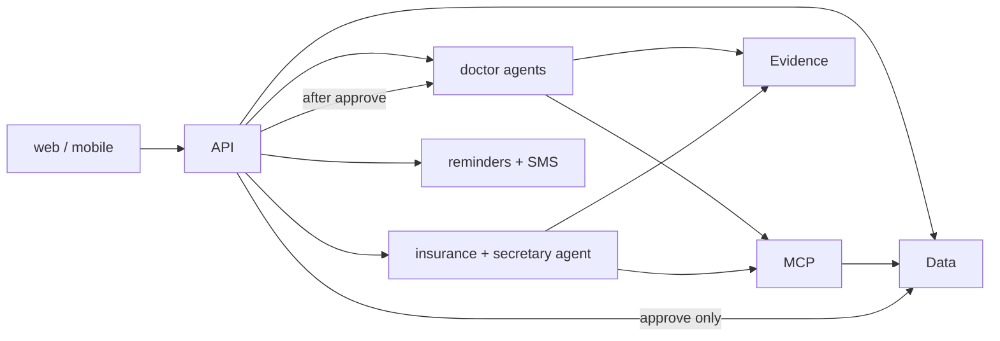

# Builder contracts

Parallel-work contract for the hackathon EMR. `system-design-routing-2.md` wins where an older graph disagrees. This file wins on names, payloads, tables, and invariants.

Workers implement only the paths they own. Shared shapes live in `backend/app/schemas/`. A worker that needs a new field adds it there first, in a separate change, before any caller or UI depends on it.

## Locked choices

- JSON uses `snake_case`. Ids are UUID strings. Timestamps are ISO-8601 UTC.
- No sign-in. Clients send `X-Role: doctor` or `X-Role: secretary`. Missing header means `doctor`. Secretary-only routes reject `doctor` with `403`.
- One doctor entry point: `POST /requests`. There is no Dictate/Ask toggle and no `/dictations` or `/asks`.
- Research answers return one JSON body. Streaming is out of this contract.
- The research agent may see this visit's pending suggestions, each labeled `unconfirmed`.
- Coverage is seeded mock data in Tiger. No Stedi client.
- Snowflake and Google Search receive a de-identified string only. No name, date of birth, phone, member id, or patient id.

## Workers

| Worker | Owns | Calls | Must not |
|---|---|---|---|
| Contracts | `backend/app/schemas/` | nothing | business logic |
| Data | `backend/app/db/`, `backend/seed/` | nothing | routes, agents |
| API | `backend/app/api/` | services below | agent prompts, SQL inside route functions |
| MCP | `backend/app/mcp/` | Data repositories | HTTP routes, Snowflake |
| Doctor agents | `backend/app/agents/doctor/` | MCP, Evidence | write chart tables |
| Insurance | `backend/app/services/eligibility.py`, `backend/app/agents/secretary/` | MCP `get_coverage`, Evidence | `propose_change`, Stedi |
| Reminders | `backend/app/services/reminders.py`, `backend/app/services/sms.py` | Data, Twilio | call the reminder agent |
| Evidence | `backend/app/evidence/` | Snowflake REST, Gemini Google Search | patient rows |
| Web | `web/` | HTTP API | database |
| Mobile | `mobile/` | HTTP API | database |



## Errors

Every error body is:

```json
{ "error": { "code": "not_found", "message": "Patient was not found." } }
```

| HTTP | code | When |
|---|---|---|
| 400 | `validation_error` | Body or query failed schema |
| 403 | `wrong_role` | Doctor called a secretary-only route |
| 404 | `not_found` | Id does not exist |
| 409 | `invalid_state` | Approve or reject a suggestion that is not `pending` |

## Shared types

```json
{
  "citation": {
    "source_id": "uspstf:colorectal",
    "title": "Colorectal cancer screening",
    "passage": "Start screening at age 40 when a first-degree relative was diagnosed at 50.",
    "locator": "USPSTF"
  },
  "suggestion": {
    "id": "uuid",
    "patient_id": "uuid",
    "request_id": "uuid or null",
    "kind": "field_update | reminder_change | soap_note | observation | plan_item",
    "status": "pending | approved | rejected",
    "target_table": "conditions | medications | family_history | observations | notes | reminder_schedule",
    "target_id": "uuid or null",
    "before": {},
    "after": {},
    "reason": "string",
    "confidence": 0.0,
    "citations": [],
    "validation_flags": ["out_of_range"],
    "source": "chart_agent | reminder_agent | lab_report | research_add_to_plan",
    "unconfirmed": false
  }
}
```

`unconfirmed` is a response-only flag. It is true when a tool is showing a `pending` suggestion to the research agent. It is not a database column.

`before` and `after` contain only allowlisted keys for `target_table`:

| target_table | keys |
|---|---|
| `conditions` | `name`, `status`, `onset_date`, `body_region_key` |
| `medications` | `name`, `dose`, `route`, `frequency`, `status`, `start_date`, `body_region_key` |
| `family_history` | `relationship`, `condition`, `age_at_diagnosis` |
| `observations` | `name`, `value`, `unit`, `observed_at`, `body_region_key` |
| `notes` | `body` |
| `reminder_schedule` | `name`, `due_on`, `status` |

`status` on a condition is `active`, `resolved`, or `controlled`. On a medication it is `active` or `stopped`. On a reminder it is `scheduled`, `paused`, `sent`, or `done`.

## Database

Tiger tables. Workers read and write them only through repositories in `backend/app/db/`. Route handlers and agents do not import SQL.

| Table | Columns that are part of the contract |
|---|---|
| `patients` | `id`, `display_name`, `date_of_birth`, `sex`, `sms_opt_in`, `phone_e164` |
| `conditions` | `id`, `patient_id`, `name`, `status`, `onset_date`, `body_region_key` |
| `medications` | `id`, `patient_id`, `name`, `dose`, `route`, `frequency`, `status`, `start_date`, `body_region_key` |
| `family_history` | `id`, `patient_id`, `relationship`, `condition`, `age_at_diagnosis` |
| `observations` | `id`, `patient_id`, `name`, `value`, `unit`, `observed_at`, `source`, `document_id`, `body_region_key` |
| `encounters` | `id`, `patient_id`, `encounter_type`, `occurred_at`, `summary` |
| `notes` | `id`, `patient_id`, `body`, `embedding`, `source_suggestion_id`, `created_at` |
| `documents` | `id`, `patient_id`, `storage_key`, `media_type`, `uploaded_at` |
| `body_regions` | `region_key`, `display_name`, `mesh_name` |
| `specialty_focus` | `specialty_key`, `region_key` |
| `reminder_rules` | `id`, `name`, `baseline_age`, `guideline_source_id` |
| `reminder_schedule` | `id`, `patient_id`, `rule_id`, `name`, `due_on`, `status` |
| `ai_suggestions` | the suggestion fields except `unconfirmed` |
| `audit_log` | `id`, `patient_id`, `suggestion_id`, `action`, `detail`, `created_at` |
| `sms_messages` | `id`, `patient_id`, `reminder_id`, `to_phone`, `body`, `twilio_sid`, `status` |
| `coverages` | `id`, `patient_id`, `payer_name`, `member_id`, `plan_name`, `active`, `deductible_remaining`, `copay`, `benefits` |
| `eligibility_checks` | `id`, `patient_id`, `coverage_id`, `order_text`, `summary`, `prior_auth_note`, `citations`, `created_at` |
| `appointments` | `id`, `patient_id`, `starts_at`, `ends_at`, `reason`, `status` |
| `requests` | `id`, `patient_id`, `channel`, `role`, `transcript`, `route`, `created_at` |

`observations.source` is `seed`, `lab_report`, or `chart`. `appointments.status` is `scheduled`, `cancelled`, or `completed`. `requests.channel` is `voice` or `typed`. `requests.role` is `doctor` or `secretary`. `requests.route` is `chart_update`, `clinical_question`, `check_screenings`, or `secretary`.

`benefits` on `coverages` is a JSON list of `{ "name", "detail" }`.

Seed loads several patients, each with conditions, meds, family history, observations, notes, a reminder schedule, one coverage row, and sample appointments. Seed does not call agents or vendors.

## API

Base path `/`. Responses are JSON. `POST /documents` and `POST /requests` with audio are `multipart/form-data`. Twilio is `application/x-www-form-urlencoded`.

### Doctor chart and body

`GET /patients/{patient_id}/body-state?specialty=cardiology`

```json
{
  "patient": { "id": "uuid", "display_name": "Jane Doe", "age": 52 },
  "specialty": "cardiology",
  "regions": [
    { "region_key": "heart", "mesh_name": "Heart", "emphasis": "focus", "pulse": true, "condition_count": 1 }
  ],
  "timeline": [
    { "at": "2024-03-01T00:00:00Z", "kind": "condition", "label": "Hypertension" }
  ],
  "trends": [
    { "name": "LDL", "unit": "mg/dL", "points": [{ "at": "2024-03-01T00:00:00Z", "value": 140 }] }
  ]
}
```

`emphasis` is `focus` or `dim`. A region pulses when it has an active condition in the selected specialty. Timeline filtering stays in the browser.

`GET /patients/{patient_id}/regions/{region_key}`

```json
{
  "region_key": "heart",
  "conditions": [],
  "medications": [],
  "observations": []
}
```

### Doctor request

`POST /requests`

Multipart fields: `patient_id`, and exactly one of `text` or `audio`. Role `doctor`.

```json
{
  "request_id": "uuid",
  "transcript": "Mark hypertension controlled.",
  "route": "chart_update",
  "suggestions": [],
  "answer": null,
  "spoken_text": "I will mark hypertension controlled.",
  "audio_base64": null
}
```

| `route` | Required output |
|---|---|
| `chart_update` | `suggestions` has the new pending rows. `answer` is null. |
| `clinical_question` | `answer` is set. `suggestions` is empty. |
| `check_screenings` | Either new `reminder_change` suggestions, or `answer` saying screenings are up to date and `suggestions` empty. |

`spoken_text` and `audio_base64` are set only when the input was audio. `audio_base64` may be null if speech synthesis fails. The JSON still returns.

`answer` when present:

```json
{
  "text": "LDL is above the range discussed in the cited guideline.",
  "citations": []
}
```

### Suggestions

`GET /suggestions?patient_id=&status=pending`

Returns `{ "suggestions": [] }`. `status` defaults to `pending`.

`POST /suggestions` creates one `plan_item` from a research answer. Role `doctor`.

```json
{ "patient_id": "uuid", "request_id": "uuid", "text": "Recheck lipids in 6 weeks", "citations": [] }
```

Response is the created suggestion. `source` is `research_add_to_plan`. This does not write the chart.

`POST /suggestions/approve`

```json
{
  "suggestion_ids": ["uuid"],
  "edits": { "uuid": { "after": { "status": "controlled" } } }
}
```

`edits` is optional. Edited keys must still be on the allowlist. Response:

```json
{
  "approved": [],
  "reminder_review": { "suggestions": [], "answer": "Screenings are up to date." }
}
```

`POST /suggestions/reject`

```json
{ "suggestion_ids": ["uuid"], "reason": "Not accurate" }
```

Response is `{ "rejected": [] }`. Chart rows stay as they were.

### Documents

`POST /documents` multipart: `patient_id`, `file`. Role `doctor`.

```json
{
  "document_id": "uuid",
  "analytes": [
    { "name": "LDL", "value": 162, "unit": "mg/dL", "observed_at": "2026-09-01T00:00:00Z", "confidence": 0.9, "flag": "out_of_range" }
  ],
  "suggestions": []
}
```

`flag` is `ok`, `low_confidence`, or `out_of_range`. Each analyte becomes one pending `observation` suggestion. The image is stored. Observations are not inserted until approval.

### Reminders and SMS

`PUT /patients/{patient_id}/reminders/{reminder_id}` role `doctor`.

```json
{ "due_on": "2026-11-01", "status": "paused" }
```

Response is the updated reminder row: `id`, `patient_id`, `name`, `due_on`, `status`. This does not create a suggestion and does not call the reminder agent.

`POST /demo/run-reminders`

```json
{ "as_of": "2026-10-09" }
```

`as_of` is optional and defaults to today.

```json
{
  "sent": [{ "reminder_id": "uuid", "sms_id": "uuid" }],
  "skipped": [{ "reminder_id": "uuid", "reason": "opted_out" }]
}
```

`POST /webhooks/twilio` accepts Twilio's form fields `MessageSid`, `MessageStatus`, and `Body`. A body of `STOP` sets that patient's `sms_opt_in` to false. The response is Twilio's empty `200`.

### Insurance and secretary

`POST /patients/{patient_id}/eligibility` roles `doctor` and `secretary`.

```json
{ "order_text": "screening colonoscopy" }
```

`order_text` may be null.

```json
{
  "coverage": {
    "payer_name": "Northwind Health",
    "member_id": "NW-1001",
    "plan_name": "PPO",
    "active": true,
    "deductible_remaining": 400,
    "copay": 30,
    "benefits": [{ "name": "Preventive colonoscopy", "detail": "Covered in network" }]
  },
  "summary": "Coverage is active. A preventive visit copay is $30.",
  "prior_auth": { "note": "This plan asks for prior auth for this order.", "citations": [] }
}
```

`prior_auth` is null when `order_text` does not raise a prior-auth question. The handler stores one `eligibility_checks` row.

`GET /appointments?patient_id=&on=2026-10-09` role `secretary`. `on` is an optional calendar date. Response is `{ "appointments": [] }` with `id`, `patient_id`, `starts_at`, `ends_at`, `reason`, `status`.

`POST /appointments` role `secretary`.

```json
{ "patient_id": "uuid", "starts_at": "2026-10-10T15:00:00Z", "ends_at": "2026-10-10T15:30:00Z", "reason": "Follow-up" }
```

`PUT /appointments/{appointment_id}` role `secretary`. Any of `starts_at`, `ends_at`, `reason`, `status`.

`POST /secretary/requests` role `secretary`. JSON `{ "patient_id", "text" }`.

```json
{
  "request_id": "uuid",
  "answer": { "text": "This plan lists prior auth for the order.", "citations": [] }
}
```

No suggestions. No chart writes.

## MCP tools

Implemented in `backend/app/mcp/`. Agents call these functions. They do not query Tiger themselves.

`get_patient_context(patient_id) ->`

```json
{
  "patient_id": "uuid",
  "age": 52,
  "conditions": [],
  "medications": [],
  "recent_observations": [],
  "family_history": [],
  "past_procedures": [],
  "reminders": [],
  "pending_suggestions": []
}
```

`pending_suggestions` are included and each has `unconfirmed: true`. `past_procedures` are encounters whose `encounter_type` is `procedure`.

`search_patient_notes(patient_id, query) -> { "notes": [{ "id", "excerpt", "observed_labs": [] }] }`

`get_coverage(patient_id) ->` the coverage object from the eligibility response, or `404` if the seed has no row.

`propose_change(patient_id, suggestion) ->` the stored suggestion.

`propose_change` inserts one `pending` row and returns it. It refuses a `target_table` outside the allowlist, an `after` key outside that table's keys, and a `reminder_change` with an empty `citations` list. It does not update chart tables.

## Evidence tools

`search_guidelines(text, corpus)` where `corpus` is `uspstf` or `pubmed`. Returns `{ "passages": [citation, ...] }`. The reminder agent may request `uspstf` only. The research agent may request either.

`search_payer_docs(text)` returns the same passage shape from insurer documents and payer policy PDFs. Used by the secretary agent and by the eligibility handler when `order_text` is present.

`web_search(text)` is its own Gemini call with Google Search grounding. It returns `{ "text", "citations" }` where each citation `locator` is a URL. The secretary agent is the only caller.

Input `text` for all three is the de-identified description. These functions drop the request if the text contains a patient id, member id, phone number, or a date of birth.

## Features and invariants

**Chart update.** `POST /requests` classified as `chart_update` reads context, proposes allowlisted changes, and stores suggestions. Voice input gets `spoken_text` describing those proposals. Approving is a separate call.

**Research.** Classified as `clinical_question`. Read-only. Every clinical claim in `answer.text` has a citation in `answer.citations`. Patient-specific statements cite a note or observation. Guideline statements cite `search_guidelines`. `POST /suggestions` is how a sentence becomes a `plan_item`.

**Reminder agent.** Runs in two cases: the doctor request was classified `check_screenings`, or `POST /suggestions/approve` finished writing the chart. It loads rules, context, and USPSTF passages. If the schedule already fits, it returns no suggestions. If it does not, it proposes a `reminder_change` with at least one citation. Approving a reminder change runs the agent again. That second run must return no suggestions when the schedule now matches, so approval cannot chain.

**Approval.** The only writer of `conditions`, `medications`, `family_history`, `observations`, `notes`, and `reminder_schedule`. One transaction marks the suggestions `approved`, applies `after` (or the edited `after`), and inserts `audit_log`. A `soap_note` or `plan_item` also embeds `after.body` or `after` text into `notes`. Reject writes `audit_log` and leaves chart tables unchanged. A second approve of the same id returns `409`.

**Manual reminder edit.** Updates `due_on` or `status` only. Does not call the reminder agent.

**SMS.** Selects reminders with `due_on <= as_of`, `status = scheduled`, and `sms_opt_in = true`. Message body has no diagnosis, medication, or lab. Stores `twilio_sid` and marks the reminder `sent`. `STOP` flips `sms_opt_in` and does not change the chart.

**Lab photo.** Stores the file, extracts analytes, inserts observation suggestions. Low confidence and out-of-range values set `validation_flags`. Nothing is written to `observations` until approval.

**Eligibility.** Reads `coverages`. Does not call an outside payer. A non-empty `order_text` may attach a prior-auth note cited from `search_payer_docs`. The plain-English `summary` is generated after that read. Doctor and secretary share this route.

**Appointments.** Create, read, and update only. No agent is involved.

**Secretary chat.** Read-only. May call `get_coverage`, `search_payer_docs`, and `web_search`. Must not call `propose_change`.

## File structure

```
backend/app/schemas/          contracts worker
backend/app/db/models.py      data worker
backend/app/db/repositories/  data worker
backend/seed/seed.py          data worker
backend/app/api/routes/       api worker, one module per group below
backend/app/mcp/tools.py      mcp worker
backend/app/agents/doctor/    doctor-agents worker
backend/app/agents/secretary/ insurance worker
backend/app/services/eligibility.py
backend/app/services/reminders.py
backend/app/services/sms.py
backend/app/evidence/         evidence worker
web/src/doctor/               web worker
web/src/secretary/            web worker
mobile/                       mobile worker
```

Route modules: `body.py`, `requests.py`, `suggestions.py`, `documents.py`, `reminders.py`, `eligibility.py`, `appointments.py`, `secretary.py`, `webhooks.py`.

Internal functions the API worker calls, and the other workers implement:

| Function | Owner | Returns |
|---|---|---|
| `route_doctor_request(patient_id, text, channel)` | Doctor agents | the `POST /requests` body |
| `approve_suggestions(ids, edits)` | API, then `run_reminder_agent` | approved suggestions plus `reminder_review` |
| `run_reminder_agent(patient_id, trigger)` | Doctor agents | `{ "suggestions", "answer" }` |
| `extract_lab_report(patient_id, storage_key)` | API | analytes and suggestions |
| `check_eligibility(patient_id, order_text)` | Insurance | the eligibility response |
| `answer_secretary(patient_id, text)` | Insurance | the secretary response |
| `send_due_reminders(as_of)` | Reminders | `{ "sent", "skipped" }` |

`trigger` is `doctor_request` or `post_approval`.

## Merge rules

- A UI change that needs a new JSON field starts in `backend/app/schemas/` and the route that returns it. Clients consume the field only after that change is in.
- Agents insert suggestions only through `propose_change`.
- Chart tables change only inside `approve_suggestions`.
- Evidence functions accept a string the caller has already stripped of identifiers. They do not take `patient_id`.
