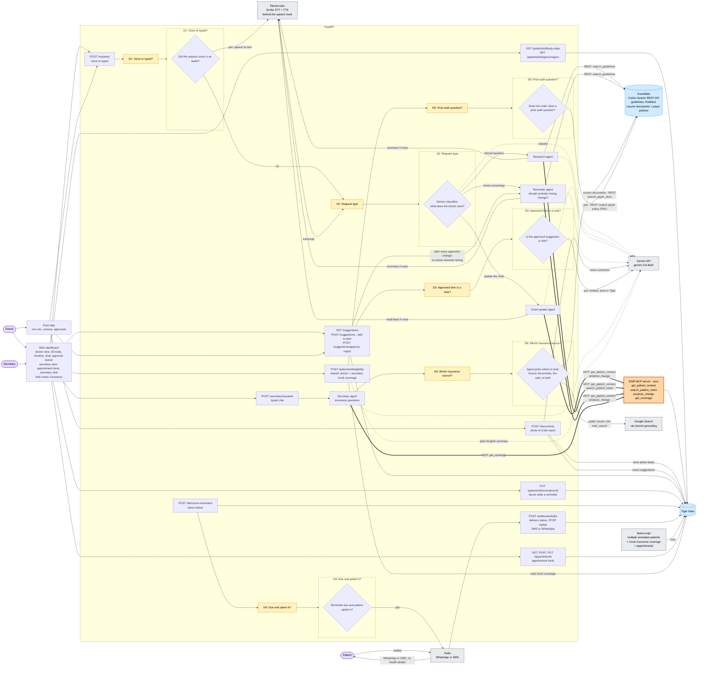

# AI-Powered EMR: Routing Graph (v2)

Hackathon build only: no scaling, caching or queues. Each database is shown as a single node.

This is one of three sources of truth. `backend-orchestrator.md` wins on phases and scope, `builder-contracts.md` wins on names, payloads, tables, and owners, and this file covers behavior neither of them specifies. Do not open or follow any other design file in this repo. Older drafts are superseded.

This file shows the full target design. The current backend build leaves some of it out (UI, a working ElevenLabs integration, scheduled sending, loading the Snowflake corpora). `backend-orchestrator.md` lists exactly what is out.

Changes from v1:

- **Snowflake is called through its REST API, not MCP.** The Snowflake MCP server is gone. `search_guidelines` is a plain Gemini function tool that sends a Cortex Search REST query with `httpx` and passes only a de-identified clinical description. The eligibility endpoint calls the same REST API.
- **The reminder agent runs after every change to a patient's record.** Approving a suggestion (`POST /suggestions/approve`) is the only thing that changes the record, so every approval triggers the reminder agent. It checks whether reminder timing should change, for example family history moving a colonoscopy from 45 to 40. Like everything else, it can only propose a change that the doctor then approves. If the doctor approves a reminder change, the agent runs again, finds nothing more to change, and stops.
- **Editing a reminder by hand doesn't trigger the agent.** `PUT /reminders` isn't a change to the patient's medical record. If it triggered the agent, the agent could suggest undoing the doctor's choice.
- **No Stedi. Insurance coverage is mock data from the seed.** Before the demo, a seed script loads several simulated patients into Tiger, each with mock insurance coverage. The eligibility endpoint reads coverage from Tiger and calls no outside insurance service.
- **New secretary role, using the web dashboard with its own view:**
  - **Appointment book:** plain create, read and update in Tiger, with no AI. The seed loads sample appointments.
  - **Insurance is shared:** the doctor and the secretary use the same eligibility endpoint. It's no longer a stretch goal.
  - **Secretary agent (typed chat, read-only):** answers insurance questions using three tools:
    - `get_coverage` (MCP): the patient's mock coverage from Tiger.
    - `search_payer_docs` (Snowflake REST): insurer internal documents loaded into Snowflake.
    - `web_search` (Google Search through Gemini): public information on how insurers handle prior auth, claims and appeals.

Changes from the first draft:

- **No Dictate/Ask toggle.** There's one mic, and typed web chat goes to the same place. Every request works like Ask did: Gemini figures out what the doctor wants and routes it. Nothing writes to the chart directly. Chart updates become suggestions the doctor approves.
- **No autonomous AI, with one exception.** Agents run only when the doctor asks. The one exception is the reminder agent, which also runs after every approval (see above). The nightly reminder-agent job is gone. Sending due reminders is plain code, not AI. In this build it runs only from the `POST /demo/run-reminders` button. A scheduler can call the same function later.

Vendors in this build:

- **Gemini:** `gemini-3.6-flash` for classification, agents, lab-photo vision, eligibility summaries and Google Search grounding. Note embeddings use `gemini-embedding-001` at 768 dimensions.
- **Files:** lab photos are stored as bytes in Tiger (`documents.content`). There is no separate file store.
- **Twilio:** reminders go out over WhatsApp when the sender number is a `whatsapp:` number, otherwise SMS. STOP replies work the same way on both.
- **ElevenLabs:** sits behind one speech hook on `POST /requests`. In this build the hook makes no network call.
- **Patient-data tools are MCP.** Every time an agent reads or proposes something in Tiger, it goes through the EMR MCP server. Those calls are the **thick arrows**.

How to read it:

- **Yellow dashed box**: a decision. It points into the subgraph with the same name.
- **Orange node**: an MCP server. **Thick arrow**: an MCP tool call.
- **Blue cylinder**: a database.
- **Arrow labeled "REST"**: a direct HTTP call to Snowflake, with no MCP in between.

## When MCP is used

| Caller | MCP server | Tools | Reaches |
|---|---|---|---|
| Chart-update agent | EMR MCP (ours) | `get_patient_context`, `propose_change` | Tiger Data |
| Research agent | EMR MCP (ours) | `get_patient_context`, `search_patient_notes` | Tiger Data |
| Reminder agent | EMR MCP (ours) | `get_patient_context`, `propose_change` | Tiger Data |
| Secretary agent | EMR MCP (ours) | `get_coverage` | Tiger Data |

## When Snowflake REST is used

| Caller | How | Searches |
|---|---|---|
| Research agent | `search_guidelines` function tool, Cortex Search REST via `httpx` | USPSTF guidelines, PubMed abstracts |
| Reminder agent | `search_guidelines` function tool, Cortex Search REST via `httpx` | USPSTF guidelines |
| Secretary agent | `search_payer_docs` function tool, Cortex Search REST via `httpx` | Insurer internal documents, payer policy PDFs |
| Eligibility endpoint | Cortex Search REST via `httpx` | Payer policy PDFs |

## When the web is used

| Caller | How | Searches |
|---|---|---|
| Secretary agent | `web_search` function tool: a separate Gemini call with Google Search grounding | Public insurer pages: prior-auth rules, claim and appeal processes |

`web_search` makes its own Gemini call instead of switching on Google Search inside the agent's main call, because some Gemini models can't combine built-in search with our own function tools in one request.

Snowflake and the web only ever receive de-identified descriptions, never patient records or identifiers.

The plain endpoints never use MCP: body view, photo upload, approvals, reminders, appointments, SMS and webhooks call the database or vendor API directly.

`propose_change` can only insert into `ai_suggestions`. Lab-photo suggestions and "add to plan" suggestions are inserted by plain code, not MCP, and are checked against the same allowlist. The only thing that writes to the chart is `POST /suggestions/approve`, after the doctor clicks it. The one exception is a doctor editing a reminder by hand (`PUT /reminders`), which changes only `reminder_schedule`.

`search_patient_notes` uses Postgres full-text search in this build. Embeddings are written when a note is approved, but nothing searches by vector yet.
